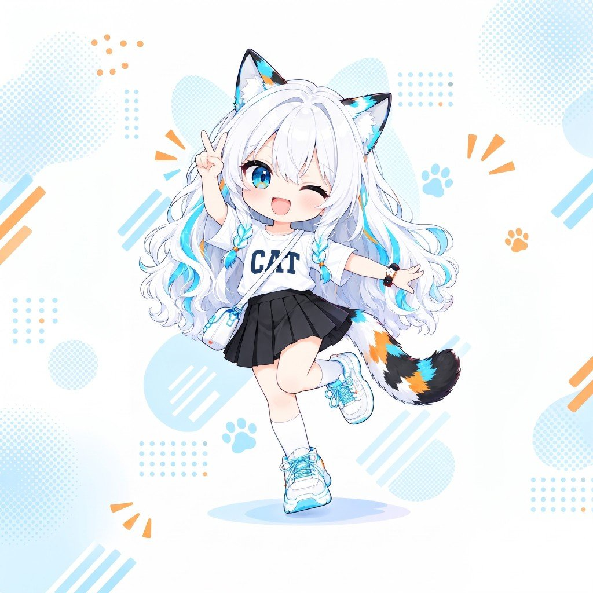
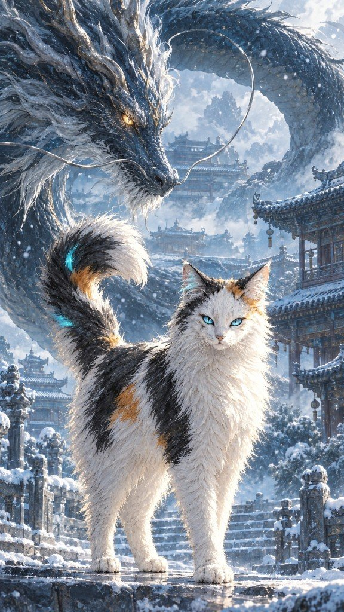
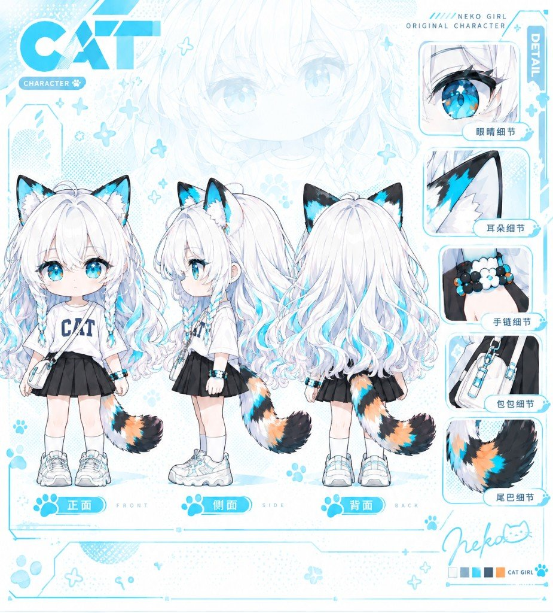
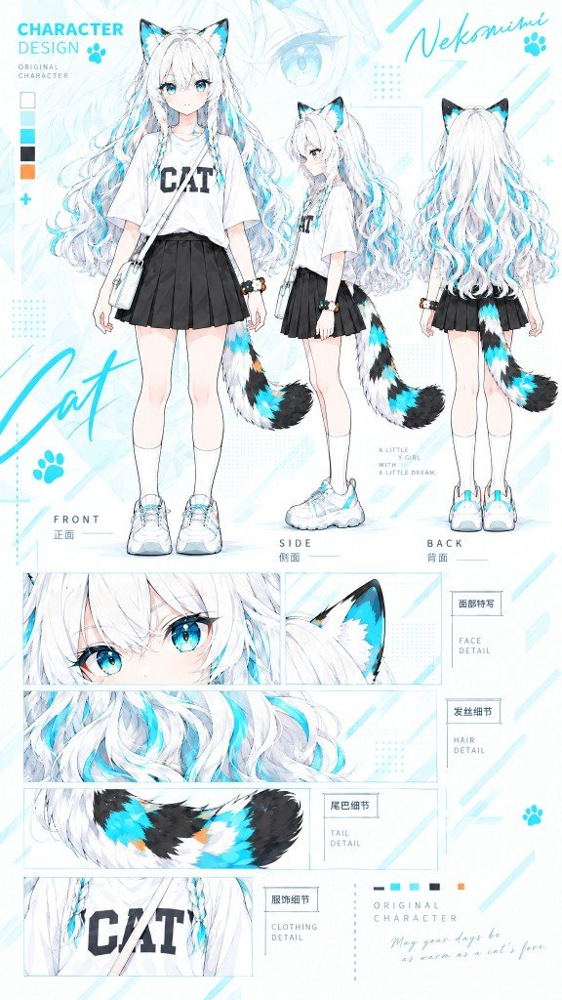
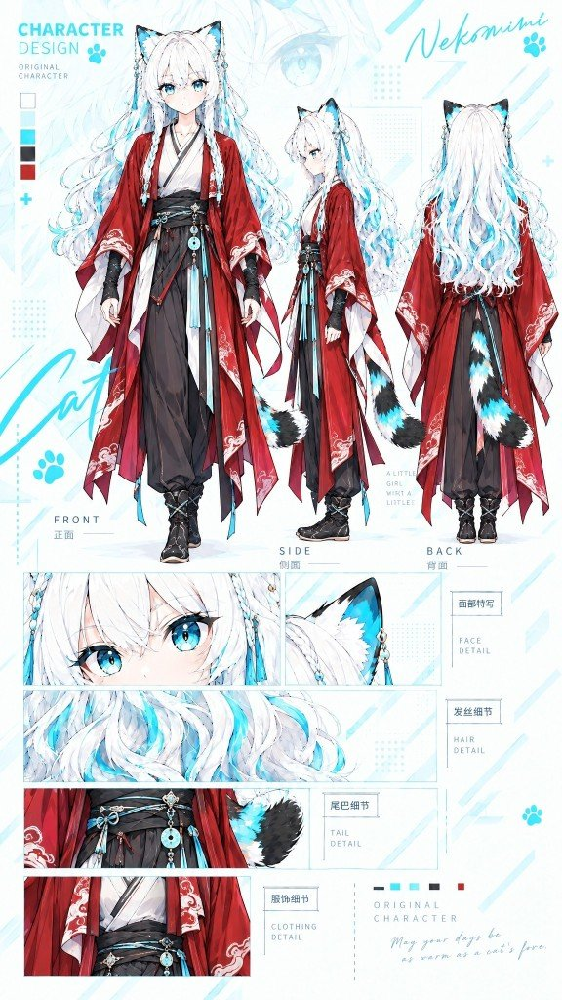

站点拟人形象：**三花猫耳「泡泡」**。默认造型与场景如下。

## 设计图

### Q 版设定

正面 / 侧面 / 背面，以及眼睛、耳朵、手链、包、尾巴等细节。

### 美型设定

全身立绘与面部、毛发、尾巴、服装细节。

### 仙侠造型

正面 / 侧面 / 背面，以及面部、发丝、尾巴、服饰细节。

## 生成说明

角色立绘、造型、三视图及 Logo 等素材均由 **AI 图像生成**，再经去底、裁切等后期处理，用于本人站点、作品与项目中的标识与展示。形象为原创拟人设定，**不关联任何商业动画 / 游戏官方角色**。
