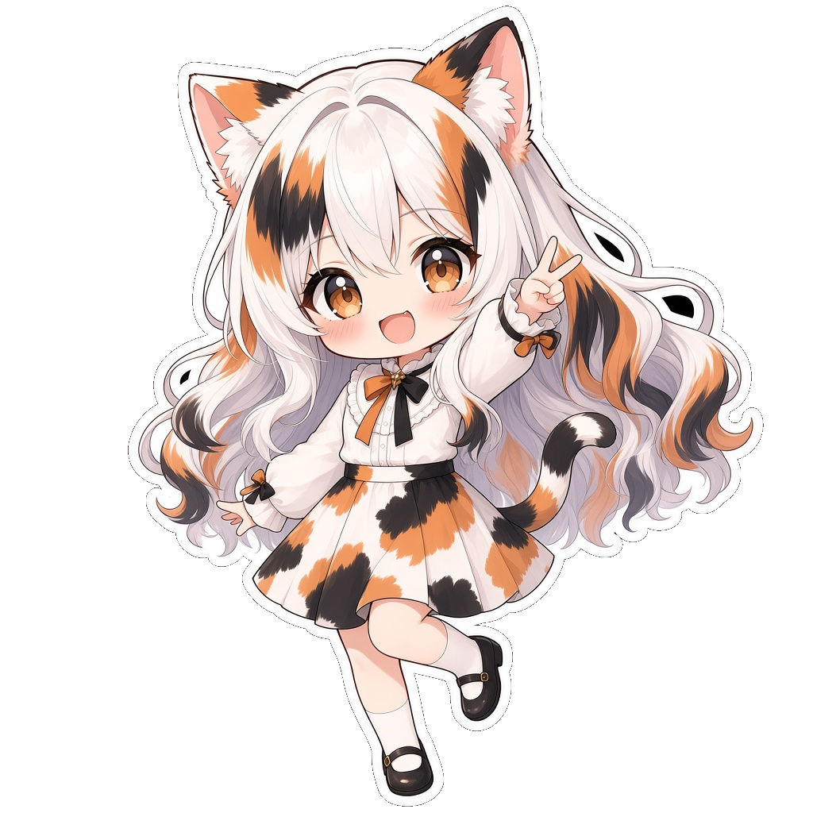
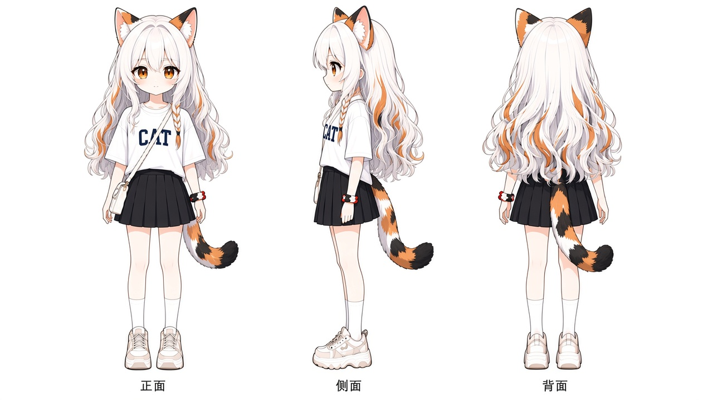
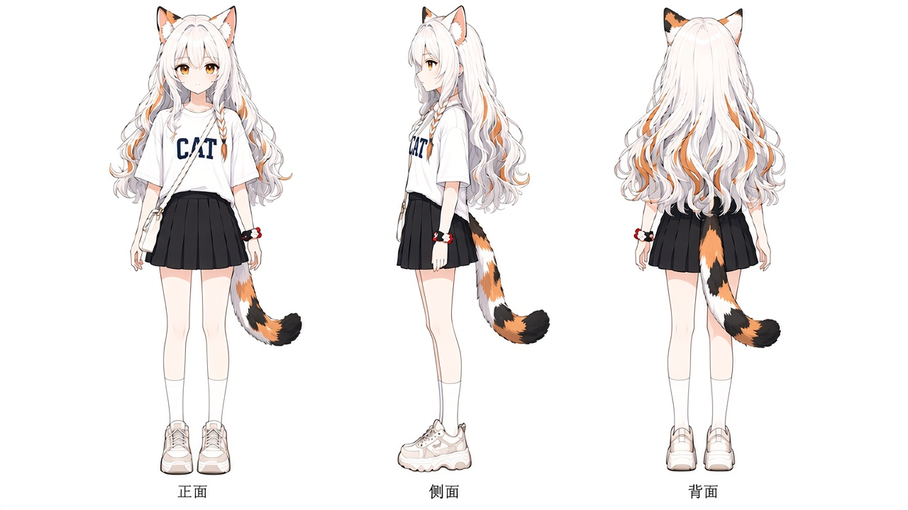
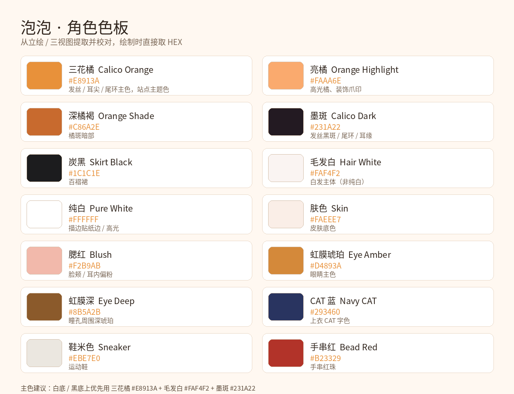

站点拟人形象：**三花猫耳「泡泡」**。默认造型与三视图如下。

## 三视图

### Q 版

### 美型

## 生成说明

角色立绘、造型、三视图及 Logo 等素材均由 **AI 图像生成**，再经去底、裁切等后期处理，用于本人站点、作品与项目中的标识与展示。形象为原创拟人设定，**不关联任何商业动画 / 游戏官方角色**。

## 角色色板

从立绘与三视图中提取并校对的常用色，绘制时可直接取 HEX。角色主色仍为三花橘 `#E8913A`；站点 UI 主题色为靛蓝 `#2563EB`，两者已脱钩。

| 名称 | HEX | 用途 |
| --- | --- | --- |
| 三花橘 | `#E8913A` | 发丝 / 耳尖 / 尾环主色 |
| 亮橘 | `#FAAA6E` | 高光橘、装饰爪印 |
| 深橘褐 | `#C86A2E` | 橘斑暗部 |
| 墨斑 | `#231A22` | 发丝黑斑 / 尾环 / 耳缘 |
| 炭黑 | `#1C1C1E` | 百褶裙 |
| 毛发白 | `#FAF4F2` | 白发主体（非纯白） |
| 纯白 | `#FFFFFF` | 描边贴纸边 / 高光 |
| 肤色 | `#FAEEE7` | 皮肤底色 |
| 腮红 | `#F2B9AB` | 脸颊 / 耳内偏粉 |
| 虹膜琥珀 | `#D4893A` | 眼睛主色 |
| 虹膜深 | `#8B5A2B` | 瞳孔周围深琥珀 |
| CAT 蓝 | `#293460` | 上衣 CAT 字色 |
| 鞋米色 | `#EBE7E0` | 运动鞋 |
| 手串红 | `#B23329` | 手串红珠 |

白底或黑底上，优先用 **三花橘 + 毛发白 + 墨斑** 三个主色搭角色识别度。
