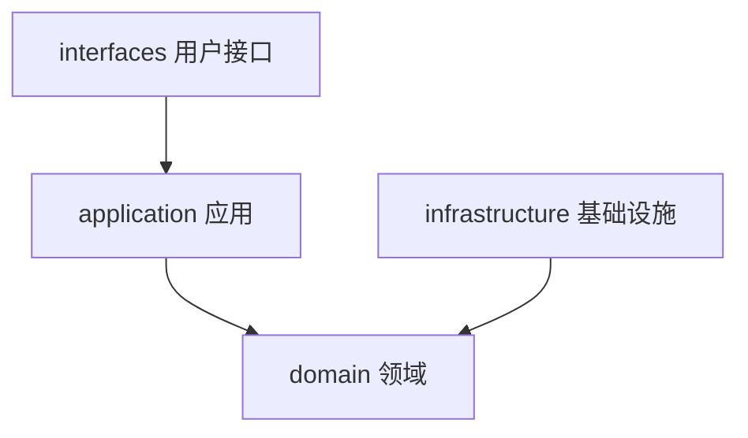
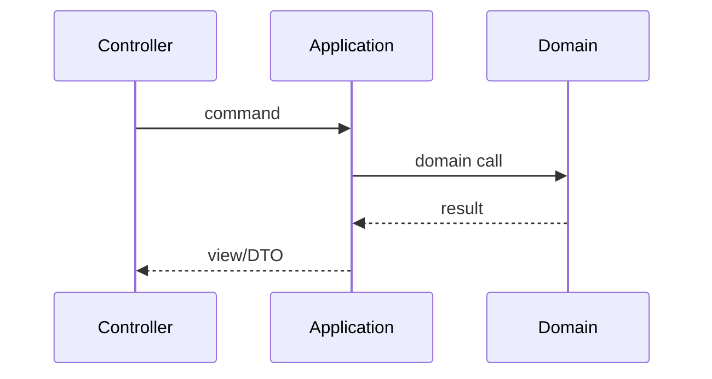
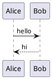

## 1. 标题层级

下面从 `##` 到 `######`（页面标题已占用 `h1`）。

### 1.1 三级标题 H3

#### 1.1.1 四级标题 H4

##### 五级标题 H5

###### 六级标题 H6

## 2. 段落与行内强调

普通段落。同一段内可以混排 **粗体**、*斜体*、***粗斜体***、~~删除线~~、==标记==、!!剧透!!，以及 `行内代码`。

上标 H~2~O / E=mc^2^，下标同理。

硬换行（`breaks: true`）会变成  
下一行。

## 3. 链接与图片

### 3.1 链接

- 行内链接：[首页](/)
- 带标题：[VuePress](https://vuepress.vuejs.org/ "VuePress")
- 自动链接：<https://jiangbyte.cn/>
- 参考式：[Theme Hope][hope]

[hope]: https://theme-hope.vuejs.press/ "vuepress-theme-hope"

站内锚点：[跳到表格](#8-表格) · [跳到 Mermaid](#12-mermaid)

### 3.2 图片


行内小图： logo。

## 4. 列表

### 4.1 无序 / 有序

- 苹果
- 香蕉
  - 芭蕉（嵌套）
  - 皇帝蕉
- 樱桃

1. 校验入参
2. 批量查询
3. 组装结果

### 4.2 任务列表

- [x] 开启 Theme Hope Markdown 能力
- [x] 完成示例清单
- [ ] 人工过一遍暗色模式
- [ ] 确认移动端 TOC

## 5. 提示容器与 GFM Alert

::: info 信息
info：解释前置条件或补充背景。
:::

::: note 备注
note：补充说明。
:::

::: tip 提示
tip：推荐做法。
:::

::: warning 注意
warning：改配置后请重新构建。
:::

::: caution 危险
caution：需要立刻注意的问题。
:::

::: important 重要
important：关键约束。
:::

::: details 点击展开
details：默认折叠的细节。
:::

> [!NOTE]
> GFM Alert：NOTE

> [!TIP]
> GFM Alert：TIP

> [!WARNING]
> GFM Alert：WARNING

> [!CAUTION]
> GFM Alert：CAUTION

## 6. 对齐 / 标记 / 布局 / 步骤

::: center
居中段落（`align`）。
:::

::: right
右对齐段落。
:::

这是 ==标记高亮==，这是 !!剧透内容!!。

:::: left

### 左栏

布局容器左侧内容。

::::

:::: right

### 右栏

布局容器右侧内容。

::::

::: steps

1. 第一步

   打开本页。

1. 第二步

   滚动核对各节渲染。

1. 第三步

   切换暗色模式再看一遍。

:::

## 7. 代码

### 7.1 行内与围栏

安装：`pnpm docs:dev`，配置键：`markdown.mermaid`。

```text
plain fence without language
```

```ts
export const site = '摸鱼猫泡泡'
```

### 7.2 行高亮

```go{3,5-6}
package demo

func Add(a, b int) int {
	return a + b
}

func main() {}
```

```html:no-line-numbers

```

### 7.3 代码选项卡

::: code-tabs#shell

@tab pnpm

```bash
pnpm docs:dev
```

@tab npm

```bash
npm run docs:dev
```

@tab yarn

```bash
yarn docs:dev
```

:::

### 7.4 文件树 / 代码树

::: file-tree

- docs
  - posts
    - java
      - 2026-10-01-Integer 缓存机制（JDK 17 源码）.md
    - git
      - 2026-10-01-双远程工作流.md
    - demo
      - 2026-10-02-Markdown特性完整测试.md
  - .vuepress
    - config.ts
    - styles
      - index.scss
      - config.scss
  - README.md

:::

::: code-tree title="示例项目"

```ts title="src/index.ts"
export const hello = () => 'world'
```

```json title="package.json"
{
  "name": "demo",
  "private": true
}
```

:::

### 7.5 Code Demo

::: normal-demo 简易 Demo

```html
<p>Theme Hope <span id="demo-em">Code Demo</span></p>
```

```js
document.querySelector('#demo-em')?.addEventListener('click', () => {
  alert('Code Demo OK')
})
```

```css
#demo-em {
  color: #3eaf7c;
  cursor: pointer;
  font-weight: 600;
}
```

:::

### 7.6 Playground

::: playground#ts TypeScript Playground

@file index.ts

```ts
const greet = (name: string) => `Hello, ${name}`
console.log(greet('Charlie'))
```

:::

### 7.7 Preview

::: preview 预览容器

**Preview** 会并排展示源码与渲染结果。

:::

## 8. 表格

| 对齐 | 左对齐 | 居中 | 右对齐 |
| :--- | :--- | :---: | ---: |
| 文本 | foo | bar | 12 |
| 代码 | `a` | `b` | 34 |
| 强调 | **粗** | *斜* | ~~删~~ |

宽表横向滚动检查：

| 维度 | Page Bundle | Leaf Page | 备注 |
| --- | --- | --- | --- |
| 图片优化 | responsive + srcset | 原图直出 | bundle 更适合大图 |
| 改造成本 | 每篇建目录 | 配置一次 | leaf 存量友好 |
| 路径稳定性 | 相对路径自然 | 绝对路径兜底 | 深层 permalink 必测 |

## 9. 脚注

这里引用一个脚注[^note-1]，再引用同一个[^note-1]，以及另一个[^note-2]。

[^note-1]: 脚注正文支持 **Markdown** 与 `code`。
[^note-2]: 第二个脚注：用于检查列表编号与返回链接。

## 10. Include / Fields / Tabs

### 10.1 Include

<!-- @include: ./_include-snippet.md -->

### 10.2 Fields

::: fields 站点信息

::: field 站点名

摸鱼猫泡泡

:::

::: field 作者

Charlie

:::

::: field 定位

文档站（无博客）

:::

:::

### 10.3 Tabs

::: tabs#demo

@tab Markdown

标准 Markdown + GFM。

@tab:active Hope

Theme Hope 增强语法。

@tab VuePress

VuePress 2 + Vite。

:::

## 11. 数学公式（KaTeX）

行内：勾股定理 \(a^2 + b^2 = c^2\)，以及质能 \(E = mc^2\)。

块级：

\[
\int_{-\infty}^{\infty} e^{-x^2}\,dx = \sqrt{\pi}
\]

$$
\begin{aligned}
\nabla \cdot \mathbf{E} &= \frac{\rho}{\varepsilon_0} \\
\nabla \cdot \mathbf{B} &= 0
\end{aligned}
$$

## 12. Mermaid





## 13. 其它图表

### 13.1 Chart.js

```chartjs
{
  "type": "line",
  "data": {
    "labels": ["一", "二", "三", "四"],
    "datasets": [
      {
        "label": "构建次数",
        "data": [2, 5, 3, 6],
        "borderColor": "#3eaf7c",
        "backgroundColor": "rgba(62,175,124,0.15)"
      }
    ]
  },
  "options": {
    "scales": { "y": { "beginAtZero": true } }
  }
}
```

### 13.2 ECharts

```echarts
{
  "xAxis": { "type": "category", "data": ["Mon", "Tue", "Wed", "Thu", "Fri"] },
  "yAxis": { "type": "value" },
  "series": [{ "data": [12, 20, 15, 8, 7], "type": "bar", "itemStyle": { "color": "#3eaf7c" } }]
}
```

### 13.3 Flowchart

```flow
st=>start: Start
op=>operation: Build docs
cond=>condition: OK?
e=>end: Done

st->op->cond
cond(yes)->e
cond(no)->op
```

### 13.4 Markmap

```markmap
# 摸鱼猫泡泡
## 文档
### Markdown
### 组件
## 工具
### Git
### Java
```

### 13.5 PlantUML



## 14. RevealJS 幻灯片

@slidestart

## 第一页

Theme Hope RevealJS

---

## 第二页

用于文档内嵌演示稿

---

## 第三页

切换全屏查看效果

@slideend

## 15. 组件

徽章：<Badge text="tip" type="tip" /> <Badge text="warning" type="warning" /> <Badge text="danger" type="danger" /> <Badge text="info" type="info" />

### 15.1 VPCard / SiteInfo

<VPCard
  title="Theme Hope"
  desc="功能丰富的 VuePress 2 主题"
  logo="https://theme-hope-assets.vuejs.press/logo.svg"
  link="https://theme-hope.vuejs.press/"
  background="rgba(62, 175, 124, 0.12)"
/>

<SiteInfo
  name="Theme Hope"
  desc="VuePress Theme Hope 文档"
  url="https://theme-hope.vuejs.press/"
  logo="https://theme-hope-assets.vuejs.press/logo.svg"
  repo="https://github.com/vuepress-theme-hope/vuepress-theme-hope"
  preview="https://theme-hope-assets.vuejs.press/logo.svg"
/>

### 15.2 媒体嵌入

@[bilibili](BV1GJ411x7h7)

## 16. 回归检查清单

打开本页时建议确认：

1. **目录**：当前项高亮清晰
2. **提示容器 / Alert**：样式完整
3. **代码**：行高亮、code-tabs、demo / playground 可交互
4. **图表**：Mermaid / Chart.js / ECharts / Flowchart / Markmap / PlantUML 已渲染
5. **公式**：行内与块级 KaTeX 正常
6. **组件**：Badge / VPCard / SiteInfo / Bilibili 正常
7. **幻灯片**：RevealJS 可翻页
8. **暗色模式**：对比度与代码块可读
9. **移动端**：TOC、宽表、代码块横向滚动
