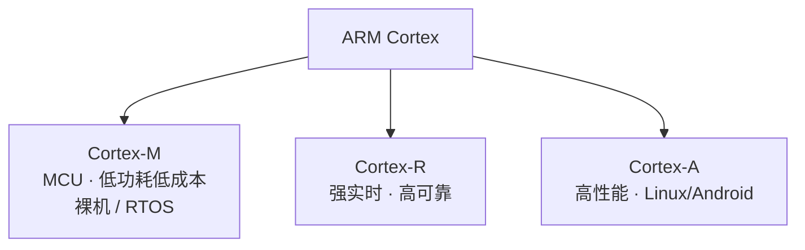
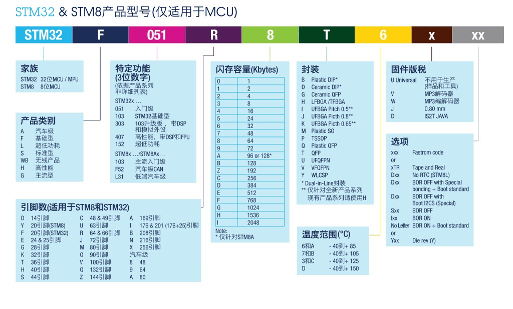
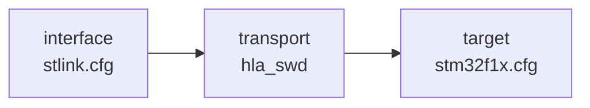
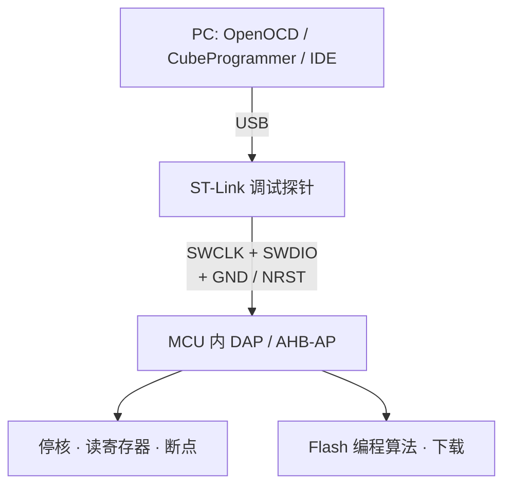
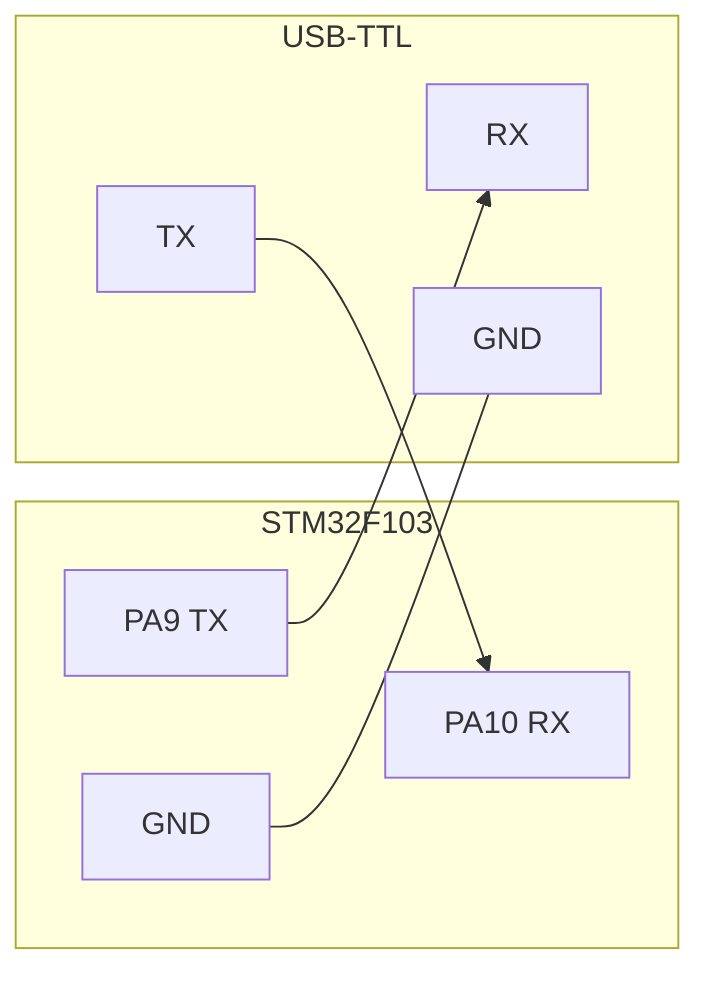
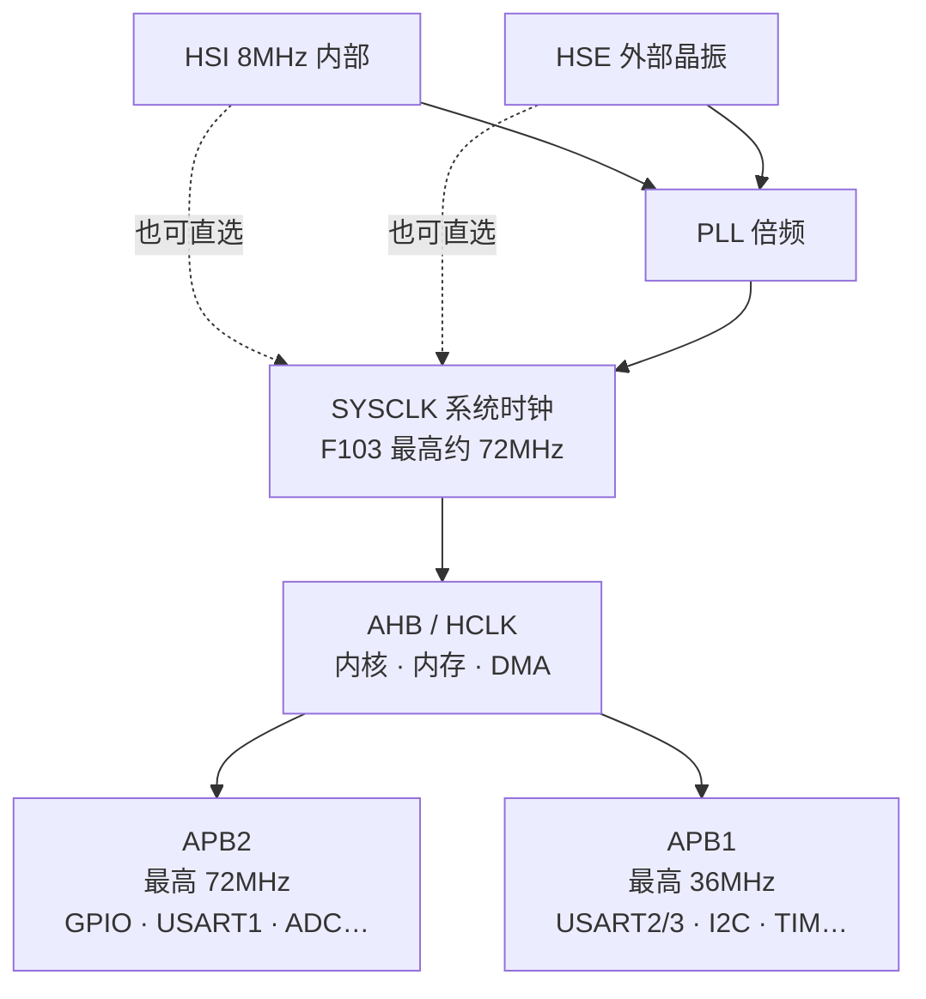

## ARM 架构

在嵌入式领域，**ARM 架构本质上是一种基于精简指令集（RISC）的处理器架构标准**，它最核心的价值在于**低功耗、低成本与高性能的平衡**，这使得它成为了移动通信、物联网和绝大多数嵌入式系统的绝对主流选择。

### 核心内涵：三个层面的“ARM”
在嵌入式语境下提到 ARM，通常指代以下三个相互关联的概念：
*   **一家公司（IP 供应商）**：ARM 公司本身不生产芯片，而是设计处理器内核（IP 核）并将技术授权给半导体厂商（如 ST、NXP、TI 等）。
*   **一类处理器通称**：指基于 ARM 内核设计出来的各类嵌入式微处理器（即各类 ARM 芯片）。
*   **一种技术/架构**：即采用 RISC（精简指令集）设计的指令集架构（ISA），强调指令长度固定、执行效率高。

### 嵌入式中的关键分类：Cortex 系列

在嵌入式选型中，基本都是 ARM 的 **Cortex 系列**，按场景分三条主线：

*   **Cortex-M**：智能仪表、工控、传感器、家电等深嵌入式。STM32 主力。  
*   **Cortex-R**：汽车制动、硬盘控制等对中断延迟极敏感的系统。  
*   **Cortex-A**：网关、工业 HMI、复杂边缘计算等需要跑富操作系统的设备。

### 为什么嵌入式偏爱 ARM？
*   **能效比极高**：RISC 架构指令精简，配合 ARM 的多级流水线设计，在同等性能下功耗远低于传统的 CISC（如 x86）架构，非常契合嵌入式设备电池供电或密闭无风扇环境的需求。
*   **丰富的生态与灵活性**：ARM 公司只卖“图纸”（IP 核），各厂商（如意法半导体、恩智浦、全志）可以基于同一个 ARM 内核，配上自己设计的外设（如不同的 ADC、通信接口），衍生出成千上万种针对不同嵌入式场景的芯片，选择面极广。

## STM32 是什么

**STM32** 是意法半导体（ST）基于 ARM **Cortex-M** 的 32 位 MCU 家族。入门常见 **STM32F103C8T6**（Blue Pill 一类）：Cortex-M3、片上 Flash/RAM 与常用外设，适合裸机或 RTOS。

开发流程都是同一套路，差别在工具组合：

## 产品型号

ST 的 MCU 订货型号可以按段拆开看（STM8 / STM32 规则类似）。下图为官方/常见对照示意：

以我常用的 **STM32F103C8T6** 为例：

| 段 | 取值 | 含义 |
|----|------|------|
| 家族 | `STM32` | 32 位 MCU |
| 产品类别 | `F` | 基础型（Foundation） |
| 系列特征 | `103` | F1 基础型系列（Cortex-M3） |
| 引脚数 | `C` | 48 脚（表中常见 48/49） |
| Flash | `8` | 64 KB |
| 封装 | `T` | QFP |
| 温度范围 | `6` | −40 °C ~ +85 °C |

读完即可对上：中等引脚、64KB Flash、工业常用温区的 F103，和 Blue Pill 一类板载芯片一致。工程里器件宏一般写 `STM32F103xB`（64KB 档与 CMSIS 头文件命名对应）。

## MCU 的 SWD 调试接口

日常说的「用 ST-Link 烧录 / 调试」，底层多半走的是 **SWD（Serial Wire Debug）**，而不是满血 JTAG。它是 ARM **CoreSight** 调试架构里的两线调试口：主机（调试器）通过很少的引脚访问芯片里的 **DAP（Debug Access Port）**，再读写内核寄存器、停核、下断点、擦写 Flash。

### 和 JTAG 比差在哪

| | SWD | JTAG（IEEE 1149.1） |
|--|-----|---------------------|
| 信号线 | 通常 **2 根**（再加 GND；可选复位、供电检测） | 通常 **4～5 根**（TCK/TMS/TDI/TDO，常加 nTRST） |
| 引脚占用 | 少，适合引脚紧的 MCU | 多，边界扫描能力更完整 |
| STM32 上 | Cortex-M 默认主推；F103 上 SWD 与 JTAG 脚复用 | 可用，但入门板 / ST-Link 默认多选 SWD |
| 工具侧 | OpenOCD 里常见 `transport select hla_swd` | `jtag` 等 |

对学习板和量产下载来说，**SWD 够用且接线更简单**。ST-Link、J-Link、CMSIS-DAP 等都支持 SWD。

### 信号与接线

最小可靠连接一般是：

| 信号 | 方向（相对 MCU） | 作用 |
|------|------------------|------|
| **SWDIO** | 双向 | 数据线（命令与响应） |
| **SWCLK** | 输入 | 时钟，由调试器给出 |
| **GND** | — | 必须共地，否则极不稳定甚至损坏 |
| **NRST**（推荐） | 输入 | 硬件复位；「复位下连接」、芯片锁死时救砖常用 |
| **VTref / 3V3**（视调试器） | — | 让调试器感知目标电压；有的线只作参考，不给板子供电 |

注意：用 ST-Link **给目标板供电** 和 **只做电平参考** 不是一回事，看具体调试器与跳线说明，避免和板载电源顶牛。

在 **STM32F103** 上，出厂默认调试脚是：

| SWD 功能 | 引脚 |
|----------|------|
| SWDIO | **PA13** |
| SWCLK | **PA14** |

这两个脚在复位后默认就是调试功能。若用户程序把它们改成普通 GPIO 并关掉调试，可能出现「烧录过一次之后再也连不上」——此时往往需要 **连接时拉住复位（Connect under reset）**，或用 Boot 脚进系统存储区再擦片。

Blue Pill / 常见最小系统还会引出 **SWD 排针**（标着 CLK / DIO / GND / 3V3），用 ST-Link 杜邦线一一对应即可。OpenOCD 侧是「接口 → 传输 → 目标」三层：

### 烧录和调试时 SWD 在干什么

- **只烧录**：探针连上 → 停核或复位 → 擦写 Flash → 再复位运行；会话可以马上断开，MCU 自己跑。  
- **在线调试**：同一条 SWD 一直挂着，GDB（如 `gdb-multiarch` + Cortex-Debug）通过 OpenOCD 发停、继续、单步、读内存。

因此：**SWD 是物理/协议层；OpenOCD、ST-Link、GDB、IDE 是叠在上面的软件。** 线没接对、地没共、NRST 悬空导致无法 under-reset，软件再对也连不上。

### 使用上容易踩的点

- **必须共地**；线尽量短，高速 SWCLK 时杜邦线过长会偶发失败。  
- **别和板载外设抢 PA13/PA14**，除非你明确会关调试并接受救砖流程。  
- 芯片开了读保护 / 选项字节异常时，SWD 可能只能做有限操作，需按手册解除 RDP 再全片擦除。  
- 同一时刻通常只允许一个工具占用 ST-Link（IDE 调试挂着时，命令行再开 OpenOCD 会抢设备）。

## USART 的 RX / TX

和 SWD 不同，**USART / UART** 是芯片上的**异步串口外设**：用来和电脑、模块、另一块板「打字传数据」，不是 CoreSight 调试口。开发里最常见的两根信号就是 **TX（发送）** 和 **RX（接收）**。

STM32 手册里多叫 **USART**（Universal Synchronous/Asynchronous Receiver Transmitter）；若只用异步收发、不跑同步时钟，习惯上也笼统说 UART。

### TX / RX 各自干什么

| 信号 | 相对本机 MCU | 含义 |
|------|--------------|------|
| **TX** | 输出 | Transmit：MCU **往外发**数据 |
| **RX** | 输入 | Receive：MCU **收进来**数据 |
| **GND** | — | 必须与对端共地 |
| **VCC**（视模块） | — | USB‑TTL 模块有的需 3V3；不要和板载电源乱并 |

接线口诀：**交叉相接**——本机 TX 对对方 RX，本机 RX 对对方 TX，再加 GND。  
若 TX 对 TX、RX 对 RX，双方都在听/都在说同一根线，通不了。

电平方面，F103 的 GPIO 是 **3.3 V** 逻辑。接 USB‑TTL 时选 3.3 V 档；5 V TTL 硬灌进 RX 有损坏风险（部分板带分压，仍以原理图为准）。

### 和 SWD 别混

| | SWD（SWDIO / SWCLK） | USART（TX / RX） |
|--|---------------------|------------------|
| 用途 | 停核、下断点、擦写 Flash | 日志、协议、和模块通信 |
| 协议 | 调试 DAP，需 ST-Link 一类探针 | 异步串口，USB‑TTL / 另一路 USART 即可 |
| F103 默认脚 | PA13 / PA14 | 由你选哪路 USART、哪组复用（见下） |
| 程序没跑起来时 | 仍常能连上调试 | 一般要靠自己代码初始化串口后才有输出 |

可以同时用：一边 SWD 调试，一边 USART1 `printf` 打日志。

### STM32F103 上常用的 RX / TX 脚

同一路 USART 往往有多组 **引脚复用**，在 CubeMX / 手册 AFIO 里选。入门最常见：

| 外设 | 默认常见映射 | 典型用途 |
|------|--------------|----------|
| **USART1** | **PA9 = TX**，**PA10 = RX** | 打日志、连 USB‑TTL；系统 BootLoader 串口下载也常用 USART1 |
| USART2 | PA2 = TX，PA3 = RX | 第二路串口、接传感器模块 |
| USART3 | PB10 = TX，PB11 = RX | 再一路扩展 |

Blue Pill 一类板常把 USART1 的 PA9/PA10 或专用排针引出；接 USB‑TTL 时 **交叉** 接线：

波特率双方一致（如 115200 8N1），终端才能看见 `printf` / 协议数据。

### 还能干什么（除了打印）

- **运行期通信**：GPS、蓝牙透传、Modbus、与另一块 MCU 对话等。  
- **UART 下载**：部分场景用 ST 系统存储区 BootLoader + USART 烧录（要配 BOOT0 等），和 SWD 下载是另一条路径；日常开发仍以 SWD 更省事。  
- **没有 SWD 时的“眼睛”**：在已能跑的程序里，串口几乎是最便宜的观测手段。

### 使用上容易踩的点

- 忘了共地，或 TX/RX 没交叉。  
- USB‑TTL 电平 5 V / 3.3 V 选错。  
- 时钟、波特率、GPIO 复用没配好，TX 脚用示波器能看到波形但 PC 乱码。  
- 把 PA13/PA14 当成「串口」——那是 SWD，不是 USART1。

## 时钟

MCU 一切节拍都来自时钟：内核跑多快、外设波特率准不准、定时器多长跳一下，都取决于 **SYSCLK** 以及分到 AHB / APB 上的频率。配错时钟时，常见现象是串口乱码、延时不准、USB 起不来。

### 时钟从哪来

以 **STM32F103** 为例，常用源：

| 源 | 典型频率 | 说明 |
|----|----------|------|
| **HSI** | 8 MHz（内部 RC） | 复位后默认；免晶振，精度一般 |
| **HSE** | 板载晶振，Blue Pill 常见 8 MHz | 更稳，做 USART/USB 前常切到它再倍频 |
| **LSI / LSE** | 约 40 kHz / 32.768 kHz | 看门狗、RTC 等低速时钟，与主频树分开 |

主频路径上还有 **PLL**：把 HSI/2 或 HSE（可再分频）倍频后得到更高的 SYSCLK。F103 主频上限通常按手册取 **72 MHz**。

### 简化时钟树（F103）

要点：

- **SYSCLK** 是系统主钟；再经 AHB 预分频得到 **HCLK**（内核与总线）。  
- **APB1 / APB2** 再从 AHB 分频；外设时钟多挂在这两条总线上。F103 上 **APB1 不得超过 36 MHz**，APB2 可到 72 MHz。  
- 某些定时器在 APB 预分频 ≠ 1 时，定时器时钟会再 ×2（查参考手册），配 PWM/延时要算清楚。  
- 打开某个外设前，除了配 GPIO，还要在 **RCC** 里打开对应时钟门控（如 `IOPCEN`、`USART1EN`），否则寄存器写了也不动。

### 入门时怎么配

复位后默认往往是 **HSI 8 MHz** 当 SYSCLK，简单闪灯、粗延时可以先不配 PLL。要稳定串口、上 USB、或把主频拉到 72 MHz，就需要在启动代码 / `SystemClock_Config`（HAL）里显式配 HSE + PLL，并保证 Flash 等待周期等与主频匹配。

CubeMX 的 Clock Configuration 页就是在画上面这张树；手写 CMSIS 时则是改 `RCC->CR` / `CFGR` 等寄存器。

## 开发方式

| 模式 | 要点 |
|------|------|
| **STM32Cube** | CubeMX 配引脚/时钟并生成代码；CubeIDE 或 CubeIDE for VS Code 编调；CubeProgrammer / CLT 烧录。官方全家桶，Win/Linux 都有。 |
| **PlatformIO** | VS Code / Cursor + PIO，`platformio.ini` 管板卡与框架，上传调试省事，适合快速试板。 |
| **VS Code + CMake + GCC + OpenOCD** | 自管工程：`arm-none-eabi-gcc`、CMake/Ninja、OpenOCD、Cortex-Debug；Linux/CI 友好。 |
| **VS Code + EIDE** | Embedded IDE 扩展在 VS Code 里管工具链与下载，偏「MDK 式」工程，Windows 用户居多。 |
| **VS Code + Keil Assistant** | VS Code 编辑，**编译调试仍靠本机 Keil MDK**，绑定 Windows。 |

可混用：例如只用 CubeMX 生成初始化代码，再放进 CMake 或 PlatformIO 工程。

