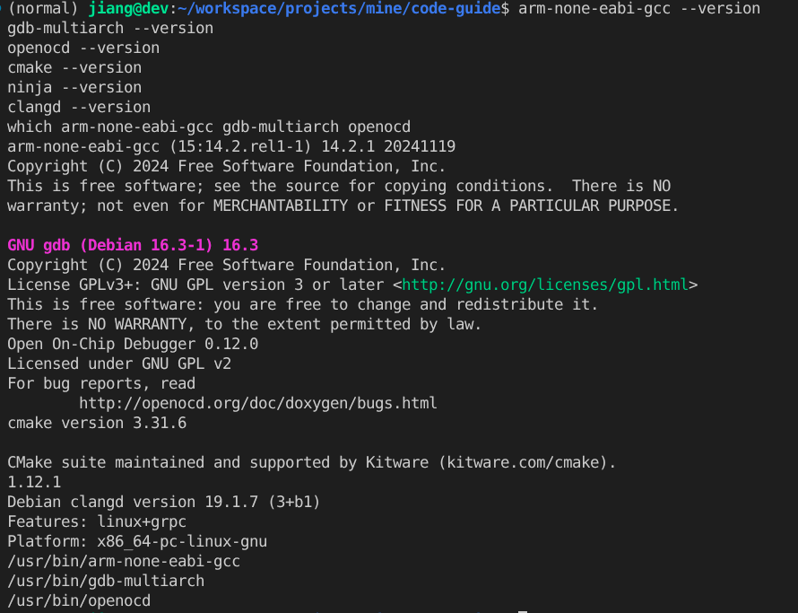

## 目标能力清单

装完并验证后，应满足：

1. `arm-none-eabi-gcc` 能交叉编译 Cortex-M 固件  
2. CMake + Ninja 能配置 / 构建出 `.elf` / `.hex` / `.bin`  
3. OpenOCD + ST-Link（SWD）能烧录并复位  
4. `gdb-multiarch` + Cortex-Debug 能断点、单步  
5. clangd 能正确解析工程头文件（靠 `compile_commands.json`）

## 本机实测版本（供对照）

以下为写作时本机 `dpkg` / 命令行读到的版本，APT 升级后数字可能变化，流程不变：

| 组件 | 包名 / 命令 | 版本示例 |
|------|-------------|----------|
| 交叉编译器 | `gcc-arm-none-eabi` → `arm-none-eabi-gcc` | 14.2.1（包 `15:14.2.rel1-1`） |
| Binutils | `binutils-arm-none-eabi` | 2.44 |
| 多架构 GDB | `gdb-multiarch` | 16.3 |
| 构建 | `cmake` / `ninja-build` | CMake 3.31.6 / Ninja 1.12.1 |
| 调试器前端 | `openocd` | 0.12.0 |
| 语言服务 | `clangd` | 19.x |
| 可选（ST udev） | `st-stlink-udev-rules` 等 | 若已装过 CubeCLT 会带上 |

> Debian / Ubuntu **通常不提供**名为 `arm-none-eabi-gdb` 的可执行文件。调试请用 `gdb-multiarch`，并在 IDE 里显式指定（见下文）。

## 用 APT 安装工具链

```bash
sudo apt update
sudo apt install -y \
  git \
  cmake \
  ninja-build \
  gcc-arm-none-eabi \
  binutils-arm-none-eabi \
  gdb-multiarch \
  openocd \
  clangd
```

说明：

- `git`：拉工程与 `git submodule`（CMSIS / HAL）  
- `cmake` + `ninja-build`：配置与并行编译  
- `gcc-arm-none-eabi` / `binutils-arm-none-eabi`：编译、链接、`objcopy` / `size`  
- `gdb-multiarch`：Cortex-Debug 的 GDB 客户端  
- `openocd`：ST-Link 烧录与 GDB Server  
- `clangd`：编辑器语义分析（与微软 C/C++ IntelliSense 二选一即可）

若已按 CubeCLT 专题装过 ST 的 udev 规则，一般可直接用 ST-Link。若从未装过，至少保证当前用户在 `plugdev` 组（Debian 桌面用户常见已在），插上 ST-Link 后：

```bash
groups                    # 宜含 plugdev
lsusb | grep -i 0483      # 例：0483:3748 ST-LINK/V2
```

权限不足时：把用户加入 `plugdev`（必要时也加入 `dialout`），重新登录，并确认 udev 规则已加载；装过 `st-stlink-udev-rules` 的机器执行：

```bash
sudo udevadm control --reload-rules
sudo udevadm trigger
# 然后拔插一次 ST-Link
```

## 命令行自检

```bash
arm-none-eabi-gcc --version
gdb-multiarch --version
openocd --version
cmake --version
ninja --version
clangd --version
which arm-none-eabi-gcc gdb-multiarch openocd
```

期望都能找到路径（多为 `/usr/bin/...`），且 **没有** 也能接受：

```bash
which arm-none-eabi-gdb   # 常见：无输出
```



## IDE：Cursor / VS Code

### 推荐扩展

与模板 `.vscode/extensions.json` 一致：

| 扩展 ID | 作用 |
|---------|------|
| `ms-vscode.cmake-tools` | CMake 配置、生成 `compile_commands.json` |
| `llvm-vs-code-extensions.vscode-clangd` | C/C++ 语言服务 |
| `marus25.cortex-debug` | 通过 OpenOCD + GDB 调试 Cortex-M |

打开带推荐扩展的工程时，按提示安装即可。

### 工作区关键设置

模板里与调试强相关的一项（Debian 必配）：

```json
"cortex-debug.gdbPath": "gdb-multiarch"
```

否则 Cortex-Debug 会去找不存在的 `arm-none-eabi-gdb`，弹出路径错误。更细的说明见模板文档  
`docs/cortex-debug-gdb-path.md`。

建议同时：

- 用 clangd 时关掉微软 C/C++ 的 IntelliSense，避免双引擎打架：`"C_Cpp.intelliSenseEngine": "disabled"`  
- CMake 配置指向交叉工具链文件，例如：  
  `CMAKE_TOOLCHAIN_FILE=cmake/gcc-arm-none-eabi.cmake`  
- 让 CMake 导出编译数据库：`CMAKE_EXPORT_COMPILE_COMMANDS=ON`（模板已开），根目录可链  
  `compile_commands.json -> build/compile_commands.json`，方便 clangd

### CMake 侧栏 vs Run and Debug

| 场景 | 用哪里 |
|------|--------|
| 配置 / 编译、看目标 | CMake 扩展可以辅助；也可用任务 / 终端 |
| **烧录后板子自己跑** | **Tasks**（见下），不要指望 CMake 面板里的 Launch |
| **断点调试** | **Run and Debug** → `Cortex Debug (OpenOCD ST-Link)` |

CMake 视图里的 Debug / Launch 若显示 `[N/A - Select Kit]`，那是本机 Kit 工作流，**不是**本模板的 OpenOCD 板级调试路径，可忽略。

## Tasks 在哪里点

「直接烧录运行」不在左侧 Run and Debug 的绿色按钮里（从那里启动一定会出调试工具栏）。

操作：

1. `Ctrl+Shift+P` → **`Tasks: Run Task`**  
   （或菜单 **Terminal → Run Task…**）  
2. 选择例如：  
   - **CMake Configure**：首次或改过 `CMakeLists.txt` 后  
   - **CMake Build**：只编译（也可用 `Ctrl+Shift+B`）  
   - **Run on Target (Flash)**：编译 + OpenOCD 烧录 + 复位，**不进入调试**

Run and Debug / F5 只用于 **Cortex Debug**：会挂 GDB，顶部出现 Continue / Step / Stop 是正常现象。

## 用模板工程走通一遍

```bash
git clone --recurse-submodules \
  git@github.com:jiangbyte/stm32f103c8t6-template.git
cd stm32f103c8t6-template

# 若克隆时未带子模块
git submodule update --init --recursive

cmake -S . -B build -G Ninja \
  -DCMAKE_BUILD_TYPE=Debug \
  -DCMAKE_TOOLCHAIN_FILE=cmake/gcc-arm-none-eabi.cmake

cmake --build build -j
```

产物在 `build/`：`firmware.elf` / `firmware.hex` / `firmware.bin`。

接好 ST-Link，确认仓库根目录 `openocd.cfg`（默认 ST-Link + `stm32f1x`）后烧录：

```bash
openocd -f openocd.cfg \
  -c "program build/firmware.elf verify reset exit"
```

或在 IDE 里跑任务 **Run on Target (Flash)**。Blue Pill 一类板上常见 PC13 LED 闪烁即表示应用在跑。

调试：Run and Debug 选 **Cortex Debug (OpenOCD ST-Link)**，首次会停在 `main`（`runToEntryPoint`），再 Continue 进入主循环。

## 与 CubeCLT / CubeMX 怎么搭配

| 需求 | 建议 |
|------|------|
| 引脚、时钟、外设图形配置 | CubeMX（见 [CLT+MX 专题](./2026-10-31-Debian安装STM32CubeCLT与STM32CubeMX.md)） |
| 命令行 / IDE 日常编烧调 | 本文 APT 工具链 + 自有 CMake 工程 |
| 已装 CubeCLT，PATH 里也有 `arm-none-eabi-gcc` | 两套可并存；CMake 工具链文件里写死要用的编译器路径，避免混用版本 |
| 只要官方一键包、少操心 APT 版本 | 以 CubeCLT 为主；注意 1.22 CLT **不含 OpenOCD**，烧录多用 CubeProgrammer |

选型没有唯一正确答案：本文路线依赖少、和发行版包管理一致，适合长期维护自己的 CMake 模板。

## 常见问题

### clangd 报 `stm32f1xx.h` file not found

头文件往往在仓库里（如 `Drivers/CMSIS/Device/...`），是 **编译数据库路径过期**。常见原因：工程目录改名 / 搬家后仍沿用旧 `build/CMakeCache.txt` 与 `compile_commands.json`（里面是绝对路径）。

处理：

```bash
rm -rf build
cmake -S . -B build -G Ninja \
  -DCMAKE_BUILD_TYPE=Debug \
  -DCMAKE_TOOLCHAIN_FILE=cmake/gcc-arm-none-eabi.cmake
# 然后 Clangd: Restart language server，或删 .cache/clangd 再重载
```

### Cortex-Debug：找不到 `arm-none-eabi-gdb`

安装 `gdb-multiarch`，工作区设置：

```json
"cortex-debug.gdbPath": "gdb-multiarch"
```

### F5 后总有调试框，想「直接执行」

正常。请用 **`Tasks: Run Task` → Run on Target (Flash)**，不要用 F5。

### OpenOCD 打不开 ST-Link

检查 USB 识别、`plugdev`、udev、线材与 `openocd.cfg` 中的 interface（`stlink.cfg`）是否匹配；另一终端占用了 OpenOCD 时先结束旧进程。

### CMake 提示 cache 路径与当前目录不一致

改名后旧 `build/` 不能直接 `cmake -S . -B build` 复用，删掉 `build` 再配置（见上文 clangd 头文件问题）。

到这里，本机嵌入式「开源工具链 + IDE」环境就算落地了。后续换芯片主要是换启动文件、链接脚本、OpenOCD target 与 CMake 里的器件宏，工具本身不用重装。
