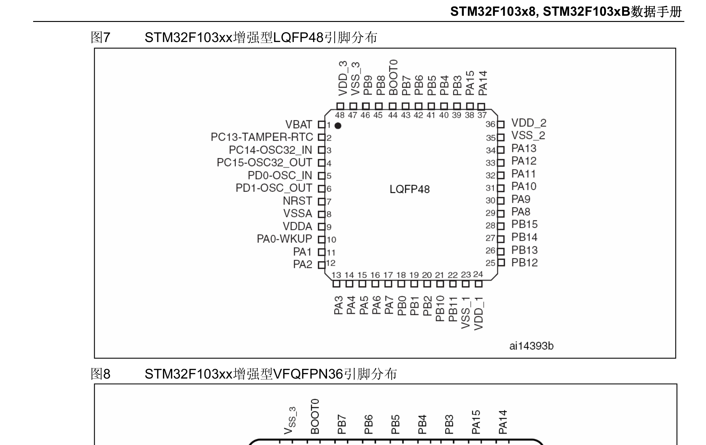

## 引脚分布

本文内容以 ST 官方文档（翻译版）为准，对应本地文件：

- 数据手册：《STM32F103x8/xB 数据手册（中文版）》（`STM32F103x8(C8T6)_数据手册_CH_V10.pdf`）——引脚分布见 **图 7**，引脚定义见 **表 5**。
- 参考手册：《STM32F10xxx 参考手册（中文版）》RM0008（`STM32F10xxx参考手册（中文）.pdf`）——AFIO 复用映射见 **第 8 章**，时钟使能见 **第 6 章 RCC**。

下图即数据手册「图 7：STM32F103xx 增强型 LQFP48 引脚分布」：

STM32F103C8T6 采用 **48 脚 LQFP（LQFP48）** 封装，是 F1 系列最常见的入门型号（Cortex-M3，64 KB Flash）。从引脚图上大致能分出几类信号：

- **电源**：多组 `VDD` / `VSS`，外加模拟供电 `VDDA` / `VSSA` 和备份供电 `VBAT`；多组电源脚都要就近接去耦电容并共地。
- **复位与启动**：`NRST` 复位脚、`BOOT0`（配合 `BOOT1`/PB2 决定启动区）——串口下载或救砖时常用到。
- **时钟**：`OSC_IN` / `OSC_OUT` 接外部晶振（Blue Pill 常见 8 MHz）。
- **调试**：`PA13`（SWDIO）、`PA14`（SWCLK）为默认 SWD 调试脚，接 ST-Link 烧录调试。
- **GPIO**：PA0–PA15、PB0–PB15、PC13–PC15、PD0–PD1，共 37 个可用的通用 IO，具体复用功能以引脚图和参考手册为准。

## 怎么看引脚图（分析思路）

拿到一颗陌生 MCU，看引脚不必死记，按下面这条线走一遍就能对上：

1. **先定封装与引脚数**。型号末尾 `T` 表示 LQFP、`C` 表示 48 脚。实物到手先数脚、看丝印，确认和引脚图是同一个封装，别拿错图。
2. **找权威的「引脚定义」表**。数据手册「引脚定义」一章的表 5 给出「引脚号 ↔ 引脚名 ↔ 复用功能」的对照（上文图 7 就是其中的 LQFP48 引脚分布）；复用映射再查参考手册第 8 章 AFIO。
3. **按功能分组扫一遍**。先找电源（`VDD` / `VSS` / `VDDA` / `VSSA` / `VBAT`），再找复位与启动（`NRST` / `BOOT0`）、时钟（`OSC_IN` / `OSC_OUT`）、调试（SWDIO / SWCLK），剩下的大头是 GPIO 及其复用。
4. **查某个引脚能干什么**。由引脚名（如 `PA9`）去 AFIO 复用表里找，看它默认和可选的外设：`PA9` / `PA10` 默认是 USART1，`PA13` / `PA14` 默认是 SWD。
5. **接线前核对三点**：这脚是否被电源 / 复位 / 调试占用；复位后的默认状态（复用、上下电电平）；用之前要不要开对应外设的时钟（RCC 门控）。

以 `PA0` 为例走一遍：它在 LQFP48 上是第 **10** 脚，标有 `WKUP`，说明还能当唤醒源；作为普通 GPIO 用时属于 **GPIOA** 端口，而 GPIOA 挂在 **APB2** 总线上，所以代码里要先 `RCC->APB2ENR |= RCC_APB2ENR_IOPAEN` 打开时钟门控，再操作 `GPIOA` 寄存器。这个过程正好对应《呼吸灯案例》里的写法。

