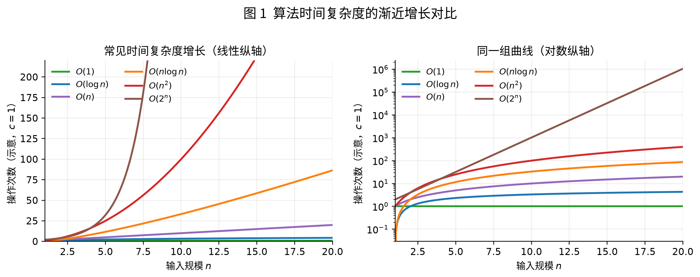
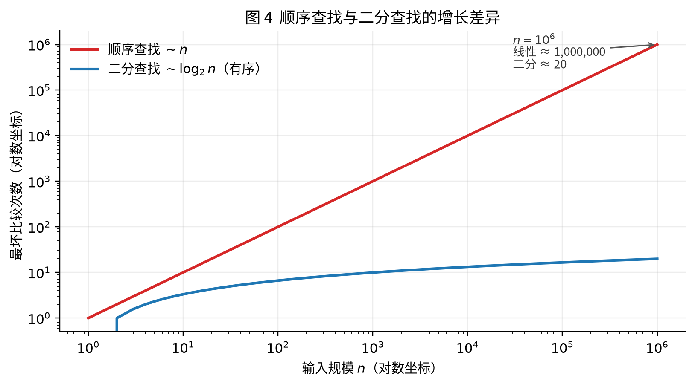
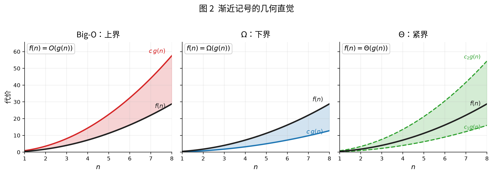
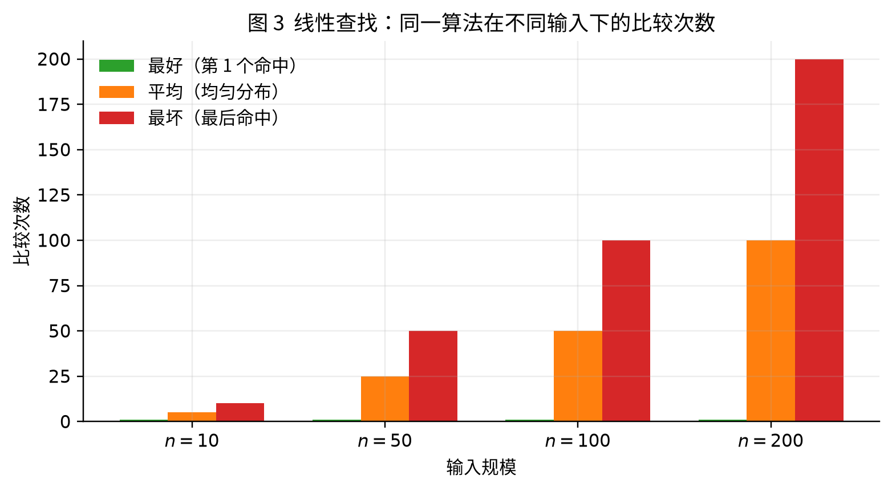
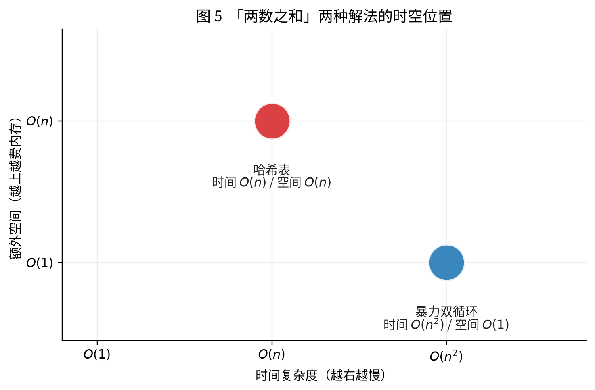

评价一个算法，除了正确性之外，通常还要回答：它有多快、额外占用多少内存。这两项在文献中常被写成时间 $O(n)$、空间 $O(1)$ 一类的渐近记号。本文说明这些记号在比什么、如何从代码结构导出，并用 Java 对操作次数做可核对的计数。

## 为什么需要评估

同一问题往往对应多种算法。以「两数之和」为例：

- 双重循环：实现直接，输入规模变大时操作次数按平方增长
- 哈希表：额外占用与规模同阶的内存，查找次数通常降为一个数量级

在可判定正确的前提下，时间与空间是比较算法优劣的两个基本维度。

常见评估维度：

| 维度 | 含义 | 常用刻画 |
| --- | --- | --- |
| 正确性 | 是否对所有合法输入给出符合规范的输出 | 规范、证明或测试集 |
| 时间效率 | 输入规模增大时，工作量如何增长 | 时间复杂度 |
| 空间效率 | 输入规模增大时，额外存储如何增长 | 空间复杂度 |
| 稳定性 / 可并行等 | 排序是否保序、能否分解计算等 | 视问题而定 |

下文集中讨论**时间**与**空间**的渐近刻画。

## 两种评估路子：实测 vs 理论估算

### 1. 实际测试（Benchmark）

把代码跑起来，用计时器量：换机器、换语言、换数据，看谁更快。

比如两个人比谁上楼快，就让他们当场跑一遍楼梯。

下面用「数操作次数」代替墙钟时间，避免机器噪音；同样能看出 $n$ 变大时谁崩得快：

```java
/**
 * 对比「单层扫描」与「双重循环」的操作次数随 n 如何增长。
 */
public class OpsGrowDemo {

    /** 单层：每元素做 1 次累加，期望约 n 次。 */
    static long linearOps(int n) {
        long ops = 0;
        long sum = 0;
        // 1. 遍历 0..n-1，每次累加计一次操作
        for (int i = 0; i < n; i++) {
            sum += i;
            ops++;
        }
        return ops;
    }

    /** 双重循环：期望约 n² 次。 */
    static long quadraticOps(int n) {
        long ops = 0;
        long sum = 0;
        // 1. 外层 n 次；内层再 n 次，合计约 n²
        for (int i = 0; i < n; i++) {
            for (int j = 0; j < n; j++) {
                sum += i + j;
                ops++;
            }
        }
        return ops;
    }

    public static void main(String[] args) {
        for (int n : new int[]{10, 100, 1000}) {
            System.out.printf(
                "n=%4d  linear=%8d  quadratic=%10d  比值≈%.1f%n",
                n, linearOps(n), quadraticOps(n),
                (double) quadraticOps(n) / linearOps(n));
        }
    }
}
```

某次运行输出：

```text
n=  10  linear=      10  quadratic=       100  比值≈10.0
n= 100  linear=     100  quadratic=     10000  比值≈100.0
n=1000  linear=    1000  quadratic=   1000000  比值≈1000.0
```

$n$ 扩大 $10$ 倍时：线性大约也扩 $10$ 倍；平方大约扩 $100$ 倍——这就是「量级」比「这台机器几毫秒」更稳的原因。

局限也很明显：

- **依赖环境**：若改成 `System.nanoTime()`，机器快慢不同，结论不好横向搬
- **依赖数据**：刚好测到「最好情况」，线上却天天撞「最坏情况」
- **难覆盖规模**：$n=100$ 时 A 更快，$n=10^7$ 时可能 B 完胜

实测适合比较具体实现在给定平台上的表现；跨平台、跨规模地比较算法本身，则依赖下文的渐近复杂度分析。

### 2. 复杂度分析（渐近分析）

不问「这台机器跑了几毫秒」，而问：

> 当输入规模 $n$ 变大时，**耗时 / 内存大概按什么趋势涨**？

不问「今天这趟电梯等了几秒」，而问「小区住户从 100 户涨到 1 万户，电梯排队会按什么规律变糟」。

优点：

- 跟 CPU、语言关系弱，比的是**增长趋势**
- 一眼能看出 $n$ 很大时谁更扛得住

这就是渐近复杂度（Big-O 等记号）所刻画的对象。更系统的叙述见 Hello 算法的效率评估一章[^hello-algo]；形式化定义见 CLRS[^clrs]。

## 时间复杂度：在比「增长趋势」

时间复杂度描述的是：**操作次数随 $n$ 增长的上界趋势**（通常取最坏情况）。

这里的「操作」可以粗理解为：比较一次、赋值一次、哈希查一次……分析时当作「差不多一个单位成本」，**不抠具体纳秒**。



*图 1　常见时间复杂度的渐近增长（左：线性纵轴；右：对数纵轴，便于同时看见慢增长与快增长曲线）。同类对照见 Wikimedia 复杂度对比图与 Big-O Cheat Sheet[^wiki-complexity][^bigocheatsheet]。*

从图中可以直观看到：

- $O(1)$、$O(\log n)$：几乎贴着地面爬
- $O(n)$、$O(n\log n)$：还能跟得上
- $O(n^2)$：已经陡了
- $O(2^n)$：稍微大一点就垂直起飞——暴力枚举子集时经常撞上

### 用代码「量」几种常见量级

```java
/**
 * 把常见复杂度对应成可数的循环 / 递归，方便对照理论曲线。
 */
public class ComplexitySamples {

    /** O(1)：下标直达，与数组长度无关。 */
    static int constantGet(int[] a, int i) {
        return a[i];
    }

    /** O(log n)：有序数组二分，每次区间减半。 */
    static int binarySearch(int[] a, int target) {
        int l = 0, r = a.length - 1, comps = 0;
        // 1. 在 [l,r] 内取中点比较；命中则返回下标
        // 2. 目标更小走左半，更大走右半，直到区间空
        while (l <= r) {
            int mid = l + (r - l) / 2;
            comps++;
            if (a[mid] == target) {
                System.out.println("二分比较次数=" + comps);
                return mid;
            }
            if (a[mid] < target) {
                l = mid + 1;
            } else {
                r = mid - 1;
            }
        }
        System.out.println("二分比较次数=" + comps);
        return -1;
    }

    /** O(n)：从头扫到尾。 */
    static int linearFind(int[] a, int target) {
        int comps = 0;
        for (int i = 0; i < a.length; i++) {
            comps++;
            if (a[i] == target) {
                System.out.println("顺序比较次数=" + comps);
                return i;
            }
        }
        System.out.println("顺序比较次数=" + comps);
        return -1;
    }

    /** O(n²)：两两组合（如暴力两数之和的骨架）。 */
    static boolean hasPairSum(int[] a, int target) {
        int n = a.length;
        long comps = 0;
        for (int i = 0; i < n; i++) {
            for (int j = i + 1; j < n; j++) {
                comps++;
                if (a[i] + a[j] == target) {
                    System.out.println("双重循环比较次数=" + comps);
                    return true;
                }
            }
        }
        System.out.println("双重循环比较次数=" + comps);
        return false;
    }

    /** O(2^n)：朴素斐波那契，调用树近似指数膨胀。 */
    static long fibOps = 0;

    static long fib(int n) {
        fibOps++;
        if (n <= 1) {
            return n;
        }
        return fib(n - 1) + fib(n - 2);
    }

    public static void main(String[] args) {
        int n = 1 << 20; // 约 10^6
        int[] sorted = new int[n];
        for (int i = 0; i < n; i++) {
            sorted[i] = i;
        }

        // 最坏：找最后一个 / 找不存在的值
        linearFind(sorted, n - 1);
        binarySearch(sorted, n - 1);

        hasPairSum(new int[]{1, 2, 3, 4, 5, 6, 7, 8, 9, 10}, 19);

        fibOps = 0;
        fib(20);
        System.out.println("fib(20) 调用次数=" + fibOps);
    }
}
```

某次运行（数量级示意，具体次数随实现略有出入）：

```text
顺序比较次数=1048576
二分比较次数=21
双重循环比较次数=45
fib(20) 调用次数=21891
```

$n\approx10^6$ 时顺序要百万次比较，二分大约 $\log_2 n\approx 20$ 次量级；`fib(20)` 已经两万多次调用——再往上指数会很难看。

### 找钥匙 / 找书：顺序 vs 二分



*图 4　最坏比较次数随 $n$ 的变化（双对数坐标）。过程示意见 Wikimedia 的顺序查找与二分查找对照图[^wiki-search]。*

- **顺序找**：书架没排序，只能一本本翻 → 大约看 $n$ 本 → $O(n)$
- **二分找**：书已按书名排好，每次砍掉一半 → 大约看 $\log_2 n$ 本 → $O(\log n)$

上面的 `linearFind` / `binarySearch` 就是在代码里把「翻了几次」打出来。

## 大 O、Ω、Θ：上界、下界、夹死

若只写「复杂度为 $O(n)$」，多数时候指**最坏情况的上界**。更严格时使用下列三种记号[^clrs][^wiki-big-o]：



*图 2　Big-$O$（上界）、$\Omega$（下界）、$\Theta$（紧界）的几何直觉。定义图示另见 Wikimedia[^wiki-big-o]。*

| 记号 | 中文直觉 | 怎么理解 |
| --- | --- | --- |
| $O$（Big-O） | 上界 | 再差也不会比这条线涨得更快（「封顶」） |
| $\Omega$（Omega） | 下界 | 再好也不会比这条线涨得更慢（「保底」） |
| $\Theta$（Theta） | 紧界 | 上下都被同阶曲线夹住（「就是这个量级」） |

**例子：** 线性查找最坏要扫完整个数组 → $O(n)$；找「是否存在某个元素」时，最坏也至少要看完（或等价信息量）→ 常有 $\Omega(n)$，合起来写 $\Theta(n)$。

算法讨论中若只写 $O(\ldots)$，通常默认表示最坏情况下的上界。

### 分析时会丢掉什么

渐近分析故意忽略：

1. **常数系数**：$3n$ 和 $n$ 都叫 $O(n)$（$3$ 被吃掉）
2. **低阶项**：$n^2 + 100n + 50$ 只留 $O(n^2)$（$n$ 很大时平方项压过一切）

用代码对照「常数被吃掉」：

```java
/** 三次扫描：仍是 O(n)，只是常数大约变成 3。 */
static long threePasses(int[] a) {
    long ops = 0;
    for (int k = 0; k < 3; k++) {
        for (int v : a) {
            ops++;
            // 假装做一点工作
            Math.abs(v);
        }
    }
    return ops; // ≈ 3n，仍记作 O(n)
}
```

比两辆车「谁更能跑高速」，你先看发动机档次，不先纠结后视镜差几克。$n$ 很大时，量级比常数更致命；$n$ 很小或常数巨大时，实测可能反过来——这点心里要有数。

## 常见时间复杂度速查

从快到慢（大致）：

| 复杂度 | 名称 | 典型场景 | 代码结构 |
| --- | --- | --- | --- |
| $O(1)$ | 常数 | 按抽屉号直接开那个抽屉 | 下标访问、哈希平均查找 |
| $O(\log n)$ | 对数 | 猜数字：每次听「大了/小了」，区间减半 | 二分、平衡树高度 |
| $O(n)$ | 线性 | 点名：每个同学喊一次 | 单层遍历 |
| $O(n\log n)$ | 线性对数 | 发牌整理：分堆再合并 | 快排 / 归并平均或典型 |
| $O(n^2)$ | 平方 | 班里两两握手：人数翻倍，握手约变 4 倍 | 双重循环（都跟 $n$ 有关） |
| $O(n^3)$ | 立方 | 三重循环枚举 | 三层嵌套 |
| $O(2^n)$ | 指数 | 每多一个开关，状态组合翻倍 | 子集枚举、朴素递归斐波那契 |
| $O(n!)$ | 阶乘 | 全排列：人一多就爆炸 | 全排列暴力 |

粗算手感（假设每秒约 $10^8\sim10^9$ 次简单操作，仅作数量级直觉）：

| $n$ | $O(n)$ | $O(n\log n)$ | $O(n^2)$ | $O(2^n)$ |
| --- | --- | --- | --- | --- |
| $20$ | 很小 | 很小 | 很小 | 约百万级，尚可 |
| $10^3$ | 轻松 | 轻松 | 约百万，通常可 | 不现实 |
| $10^6$ | 通常可 | 通常可 | 约 $10^{12}$，危险 | 不可能 |
| $10^8$ | 要抠常数 / 语言 | 吃紧 | 基本不行 | 不可能 |

若假定每秒约 $10^8\sim10^9$ 次简单操作，则 $n\le 100$ 时 $O(n^2)$ 往往仍可完成；$n\le 10^5$ 时通常需要 $O(n\log n)$ 或更优。常见结构与排序算法的复杂度表见 Big-O Cheat Sheet[^bigocheatsheet]。

## 最好、平均、最坏：同一算法三种脸



*图 3　线性查找在不同输入位置下的比较次数：最好恒为 $1$，平均约 $n/2$，最坏为 $n$。*

一排抽屉找钥匙——

- **最好**：钥匙在第一个 → 翻 $1$ 次
- **平均**：钥匙大致均匀分布 → 大约翻一半
- **最坏**：钥匙在最后一个 → 翻满 $n$ 次

用返回值把「翻了几次」算出来：

```java
/**
 * 线性查找：返回 [下标, 比较次数]；找不到下标为 -1。
 */
static int[] linearSearchCount(int[] a, int target) {
    int comps = 0;
    // 1. 从左到右比较；命中则带着比较次数返回
    // 2. 扫完仍无则返回 -1 与 comps=n
    for (int i = 0; i < a.length; i++) {
        comps++;
        if (a[i] == target) {
            return new int[]{i, comps};
        }
    }
    return new int[]{-1, comps};
}

public static void demoBestAvgWorst() {
    int[] a = {3, 1, 4, 1, 5, 9, 2, 6}; // n=8
    System.out.println(java.util.Arrays.toString(linearSearchCount(a, 3))); // 最好：[0, 1]
    System.out.println(java.util.Arrays.toString(linearSearchCount(a, 5))); // 靠中间：[4, 5]
    System.out.println(java.util.Arrays.toString(linearSearchCount(a, 6))); // 最坏：[7, 8]
    System.out.println(java.util.Arrays.toString(linearSearchCount(a, 7))); // 找不到：[-1, 8]
}
```

某次输出：

```text
[0, 1]
[4, 5]
[7, 8]
[-1, 8]
```

同一算法：最好 $1$ 次比较，最坏 $n$ 次。未特别声明时，时间复杂度通常取**最坏情况**。

再以快速排序为例：

- 平均情况约为 $O(n\log n)$
- 最坏情况为 $O(n^2)$（划分持续极度不平衡）

因此「快排很快」在理论上应标明所指是平均情况；改变枢轴选取方式（随机枢轴、三数取中等）会改变最坏或期望意义下的界。

## 空间复杂度

空间复杂度描述算法运行时占用的存储随 $n$ 如何增长。分析中常单独给出**辅助空间**（不含存放输入本身所需的空间）[^hello-algo]。

- 输入所占空间视为问题给定，一般不计入辅助空间
- 哈希表、递归调用栈、临时数组等由算法额外申请的部分，计入辅助空间

| 写法 | 辅助空间 |
| --- | --- |
| 仅常数个标量 | $O(1)$ |
| 长度为 $n$ 的数组或哈希表 | $O(n)$ |
| 递归深度最坏为 $n$ | 栈空间 $O(n)$ |
| 更宽的递归调用树（未优化） | 需按实际栈深度另行分析 |

同一问题两种空间写法——原地反转 vs 开新数组：

```java
/** 原地反转：只用左右指针，额外空间 O(1)。 */
static void reverseInPlace(int[] a) {
    int i = 0, j = a.length - 1;
    // 1. 两端向中间交换，直到交错
    while (i < j) {
        int t = a[i];
        a[i] = a[j];
        a[j] = t;
        i++;
        j--;
    }
}

/** 开新数组反转：额外空间 O(n)。 */
static int[] reverseCopy(int[] a) {
    int n = a.length;
    int[] b = new int[n];
    // 1. 按逆序写入新数组，不改动原数组
    for (int i = 0; i < n; i++) {
        b[i] = a[n - 1 - i];
    }
    return b;
}
```

时间都是 $O(n)$，辅助空间分别为 $O(1)$ 与 $O(n)$。

## 时间与空间的权衡



*图 5　「两数之和」两种解法在时间—额外空间平面上的相对位置。*

经典「两数之和」：

$$
\begin{aligned}
&\text{暴力双循环：时间 } O(n^2),\ \text{额外空间 } O(1) \\
&\text{哈希一遍扫：时间 } O(n),\ \text{额外空间 } O(n)
\end{aligned}
$$

```java
import java.util.HashMap;
import java.util.Map;

/**
 * LeetCode 1. Two Sum 两种解：用操作计数对比量级（不是墙钟时间）。
 */
public class TwoSumTradeoff {

    /** 暴力：两两相加。额外空间 O(1)。 */
    static int[] twoSumBrute(int[] nums, int target, long[] opsOut) {
        long ops = 0;
        int n = nums.length;
        // 1. 枚举所有 (i,j)，i<j；命中则返回下标
        for (int i = 0; i < n; i++) {
            for (int j = i + 1; j < n; j++) {
                ops++;
                if (nums[i] + nums[j] == target) {
                    opsOut[0] = ops;
                    return new int[]{i, j};
                }
            }
        }
        opsOut[0] = ops;
        return new int[]{-1, -1};
    }

    /** 哈希：一边走一边记「还差多少」。额外空间 O(n)。 */
    static int[] twoSumHash(int[] nums, int target, long[] opsOut) {
        long ops = 0;
        Map<Integer, Integer> need = new HashMap<>();
        // 1. 对每个 x：若 target-x 已见过则返回
        // 2. 否则把 x 的下标放进表，供后面匹配
        for (int i = 0; i < nums.length; i++) {
            ops++;
            int x = nums[i];
            Integer j = need.get(target - x);
            ops++; // 计一次查找
            if (j != null) {
                opsOut[0] = ops;
                return new int[]{j, i};
            }
            need.put(x, i);
        }
        opsOut[0] = ops;
        return new int[]{-1, -1};
    }

    public static void main(String[] args) {
        int n = 2000;
        int[] nums = new int[n];
        for (int i = 0; i < n; i++) {
            nums[i] = i;
        }
        int target = (n - 2) + (n - 1); // 逼到数组末尾，暴力接近最坏

        long[] ops = new long[1];
        twoSumBrute(nums, target, ops);
        System.out.println("暴力 ops≈" + ops[0]);

        ops[0] = 0;
        twoSumHash(nums, target, ops);
        System.out.println("哈希 ops≈" + ops[0]);
    }
}
```

某次输出（$n=2000$，目标在末尾附近）：

```text
暴力 ops≈1999000
哈希 ops≈4000
```

同一正确性约束下，降低时间往往以提高辅助空间为代价，反之亦然；上例给出了可计数的数量级对照。

## 从代码结构导出复杂度

### 1. 循环嵌套

```java
// 外层 n、内层 n → O(n²)
for (int i = 0; i < n; i++) {
    for (int j = 0; j < n; j++) {
        // O(1) 工作
    }
}
```

注意：内层若是 `j = i; j < n; j++`，仍是平方量级；内层若与 $n$ 无关（固定 $3$ 次），外层仍是 $O(n)$。

### 2. 问题规模按常数比例缩小

```java
// 区间每次减半 → O(log n)
while (l <= r) {
    int mid = l + (r - l) / 2;
    // ...
}
```

### 3. 递归：规模缩减方式与每层代价

- 规模减半且每层 $O(1)$ → $O(\log n)$
- 每层总工作 $O(n)$、深度约 $\log n$ → $O(n\log n)$（典型分治排序）
- $f(n)=f(n-1)+f(n-2)$ 且无记忆化 → 调用次数约为 $O(2^n)$（见上文 `fib`）

对斐波那契引入长度为 $n$ 的记忆表后，每个子问题至多计算一次，时间降为 $O(n)$，辅助空间 $O(n)$：

```java
/** 记忆化斐波那契：时间 O(n)，辅助数组 O(n)。 */
static long fibMemo(int n, long[] memo) {
    if (n <= 1) {
        return n;
    }
    if (memo[n] != 0) {
        return memo[n];
    }
    // 1. 先求子问题，再写入 memo，避免重复展开
    memo[n] = fibMemo(n - 1, memo) + fibMemo(n - 2, memo);
    return memo[n];
}
```

### 4. 平均、均摊与最坏

三者不可互换。例如哈希表查找的平均代价常为 $O(1)$，但在退化情形下可至 $O(n)$；陈述时应标明所指情形。

### 5. 多段算法取主导项

若先 $O(n\log n)$ 排序，再 $O(n)$ 扫描，总和仍为 $O(n\log n)$（高阶项主导）。

```java
java.util.Arrays.sort(a); // O(n log n)
int max = a[0];
for (int v : a) {         // O(n)
    max = Math.max(max, v);
}
// 整体 O(n log n)
```

## 与正确性的关系

正确性讨论算法是否对所有合法输入给出符合规范的输出；复杂度讨论在正确的前提下，资源消耗随输入规模如何增长。二者相互独立：正确但指数时间的算法，与错误但线性时间的程序，都不能替代对方所回答的问题。

渐近记号还忽略常数因子。因此当 $n$ 很小或实现常数很大时，墙钟时间上的优劣不必与 $O(\cdot)$ 的排序完全一致；后者描述的是规模趋于无穷时的增长形态。

## 参考文献

[^hello-algo]: 空嵌. *Hello 算法*：算法效率评估. <https://www.hello-algo.com/chapter_computational_complexity/performance_evaluation/>

[^clrs]: Thomas H. Cormen, Charles E. Leiserson, Ronald L. Rivest, Clifford Stein. *Introduction to Algorithms*, 3rd ed., MIT Press, 2009. 相关章节：Asymptotic Notation（约 pp. 43–64）.

[^wiki-complexity]: Cmglee. *Comparison computational complexity*. Wikimedia Commons. <https://commons.wikimedia.org/wiki/File:Comparison_computational_complexity.svg>

[^bigocheatsheet]: Eric Rowell. *Big-O Algorithm Complexity Cheat Sheet*. <https://www.bigocheatsheet.com/>

[^wiki-search]: *Binary search vs Linear search example*. Wikimedia Commons. <https://commons.wikimedia.org/wiki/File:Binary_search_vs_Linear_search_example_svg.svg>

[^wiki-big-o]: *Big-O notation*. Wikimedia Commons. <https://commons.wikimedia.org/wiki/File:Big-O-notation.png>

