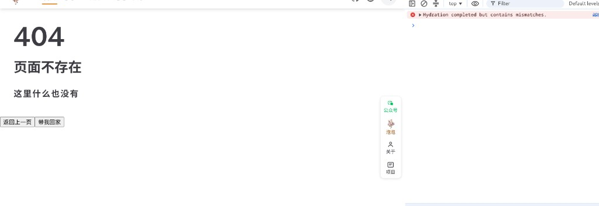
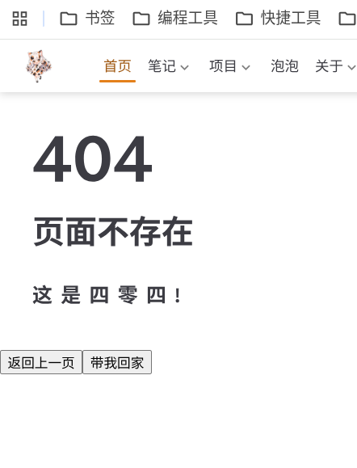
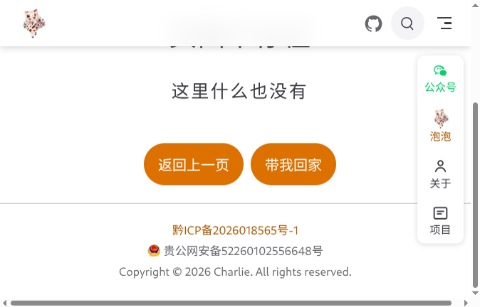

## 占位符

| 写法 | 含义 |
| --- | --- |
| `【域名】` | 主站域名，如 `jiangbyte.cn` |
| `【网关目录】` | 宿主机网关根目录，如 `/root/deploy/nginx` 或 `/opt/nginx-gateway` |
| `【容器名】` | 网关容器名，如 `nginx-gateway` |

改的是 **`【网关目录】/conf.d/`** 里主站 conf，不是 `html/`。`html/` 只放构建产物。

## 现象

线上偶发或固定出现：

- 页面像「没加载 CSS」：大字 404、灰框原生按钮、布局松散
- 导航 Logo / 自写悬浮栏有时仍在，更像「半套样式」
- 控制台可能有 `Hydration completed but contains mismatches`
- 硬刷新、换路径后表现不稳定

本站是 VuePress + Theme Hope，经 Docker Nginx 网关托管；发版用 `rsync --delete` 同步 `docs/.vuepress/dist/` → `html/`。

修复前截图（控制台 Hydration mismatch + 页面几乎裸奔）：



只改了 `/assets/` 仍回首页时，404 文案在，但按钮仍是系统灰框：



## 排查过程

### 1. 先确认构建产物本身正常

本地 / 线上 HTML 里样式引用是绝对路径，例如：

```html
<link rel="stylesheet" href="/assets/style-XXXX.css">
```

直接请求当前 HTML 里的真实 CSS 地址，若返回 `200` 且 `content-type: text/css`，说明**当时那一版产物和文件在磁盘上是齐的**，问题更可能在网关规则或缓存，而不是「没打出 CSS」。

### 2. 制造一个「不存在的 CSS」看 Nginx 怎么回

```bash
curl -sI "https://【域名】/assets/style-DOES-NOT-EXIST.css"
```

**踩坑时的错误表现：**

| 项 | 错误表现 |
| --- | --- |
| 状态码 | `200` |
| Content-Type | `text/html` |
| 正文 | 首页 `index.html` |

浏览器以为在加载样式，实际吃到一整页 HTML → 解析失败 → **整站看起来样式丢失**。

根因是主站把所有找不到的路径都兜进了首页：

```nginx
location / {
    try_files $uri $uri/ /index.html;
}
```

这对纯 SPA 常见，但对「带 hash 的静态资源」很危险：`rsync --delete` 删掉旧 `style-旧hash.css` 后，旧 HTML / 缓存仍引用旧地址，就会踩中上面这条回退。

### 3. 缺页时回的是「首页」，不是 404 页

```bash
# 真正的 404 页
curl -s "https://【域名】/404.html" | grep -oE 'class="[^"]*vp-page[^"]*"'
# → vp-page not-found

# 随便一个不存在的路径
curl -s "https://【域名】/definitely-missing-xyz" | grep -oE 'class="[^"]*vp-page[^"]*"'
# → vp-page vp-project-home   （首页结构）
```

Theme Hope 里 404 按钮样式依赖父级 class，例如：

```css
.vp-page.not-found .action-button { /* 主题色圆角按钮 */ }
```

缺页时 Nginx 先吐出**首页 SSR DOM**（`vp-project-home`），客户端再画 404 文案和 `.action-button`。父级对不上选择器 → 按钮变成浏览器默认灰框，看起来像样式丢了。导航 / 悬浮栏不依赖 `.not-found`，所以还能「看起来有样式」。

同时：首页 HTML 灌进错误路径，容易和客户端 404 路由不一致，控制台出现 **Hydration mismatch**（悬浮栏等 `rootComponents` 会放大这种不一致，但不是卸掉 `<link>` 的主因）。

### 4. 改 `/assets/` 单独拦截之后

为静态资源加上真实 404 后：

```bash
curl -sI "https://【域名】/assets/style-DOES-NOT-EXIST.css"
# HTTP/2 404
# content-type: text/html   ← Nginx 默认短错误页即可，关键是不要再回首页
```

真实 CSS 可带长缓存：

```text
cache-control: public, max-age=31536000, immutable
```

这一步能消除「缺失 CSS 被当成 HTML」；**缺页仍回首页**时，404 按钮灰框问题还会在。

## 修复

改 **`【网关目录】/conf.d/`** 主站 `server`（`listen 443` 那段），在 `root` / `index` 后写成：

```nginx
root /usr/share/nginx/html;
index index.html;

# 1. 静态资源禁止回退到 HTML
location /assets/ {
    try_files $uri =404;
    add_header Cache-Control "public, max-age=31536000, immutable";
}

# 2. VuePress 多页静态站：缺页回 404.html，不要回 index.html
location / {
    try_files $uri $uri.html $uri/ /404.html;
}
```

说明：

| 点 | 原因 |
| --- | --- |
| 改 `conf.d`，不改 `html` | 路由规则在 conf；`html` 只是产物目录 |
| `/assets/` 在 `/` 前单独写 | 避免被 `location /` 的 try_files 吞掉 |
| 回退 `/404.html` 而非 `/index.html` | VuePress 预渲染了真正的 404 页，SSR class 才是 `not-found` |
| `$uri.html` | 兼容 `/foo` → `/foo.html` 这类路径 |

改完校验并重载：

```bash
docker exec 【容器名】 nginx -t
docker exec 【容器名】 nginx -s reload
```

浏览器对问题页做一次强制刷新（避免旧 HTML 仍指向已删除的 CSS hash）。

修复后：缺页落到真正的 `404.html`，按钮恢复主题色圆角：



## 验证清单

```bash
# 缺失 CSS 必须是真 404，不能是首页
curl -sI "https://【域名】/assets/style-DOES-NOT-EXIST.css" | grep -iE 'HTTP/|content-type'

# 当前首页引用的 CSS 应为 text/css
STYLE=$(curl -s "https://【域名】/" | grep -oE '/assets/style-[^"]+\.css' | head -1)
curl -sI "https://【域名】${STYLE}" | grep -iE 'HTTP/|content-type|cache-control'

# 不存在的路径应落到 404 页结构
curl -s "https://【域名】/this-path-should-404" | grep -oE 'vp-page not-found|vp-project-home'
# 期望能看到 not-found，而不是只有 vp-project-home
```

页面上：404 按钮应为主题色圆角，而不是系统灰框。

## 和发版的关系

`rsync -avz --delete` 会删掉上一版 hash 资源。若：

1. HTML 短时间仍是旧版（浏览器缓存 / 未刷新），或  
2. 缺失的 `.css` 被 `try_files` 回成 `index.html`，  

就会稳定复现「样式丢失」。

建议：

- HTML：短缓存或不缓存  
- `/assets/*`：长缓存 + `immutable`（hash 变了就是新 URL）  
- 资源路径不要用「找不到就回首页」的通用兜底  

## 小结

| 层 | 问题 | 处理 |
| --- | --- | --- |
| `/assets/` | 缺失 CSS 被回成首页 HTML | `try_files $uri =404` |
| 缺页 | 回 `/index.html`，SSR 是首页 class | 改回 `/404.html` |
| 观感 | 404 按钮灰框、像没样式 | 父级补上 `not-found` 后主题 CSS 生效 |
| 控制台 | Hydration mismatch | 缺页勿再灌首页 DOM；可另排 `rootComponents` |

相关笔记：[Docker Nginx 通用反向代理网关](./2026-10-28-Docker%20Nginx%20通用反向代理网关.md)、[静态站点部署与持续交付](./2026-10-28-静态站点部署与持续交付.md)。
