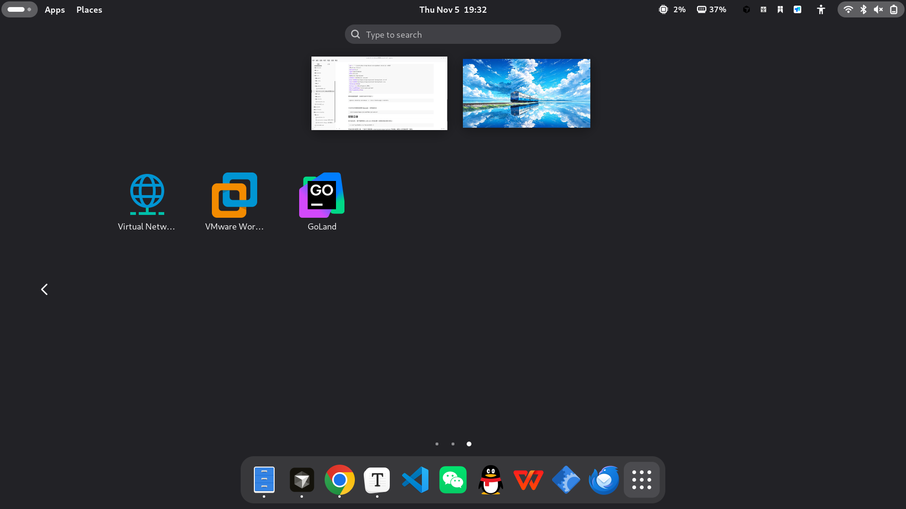

## 目标

用 JetBrains 官方 **Linux `.tar.gz`** 安装 GoLand，目录约定如下：

| 路径 | 用途 |
|---|---|
| `~/workspace/apps/goland` | 安装目录 |
| `~/.local/share/applications/goland.desktop` | 应用菜单入口 |

下文以 **GoLand 2025.3.5.2**（build `GO-253.33813.96`）为例，适用于 Debian 桌面环境。

## 下载

官方下载页：[https://www.jetbrains.com/go/download/](https://www.jetbrains.com/go/download/)

选择 **Linux** 的 `.tar.gz`。下载完成后确认文件：

```bash
ls -lh ~/Downloads/goland-*.tar.gz
# 示例：goland-2025.3.5.2.tar.gz 约 1.1G
```

查看压缩包顶层目录名：

```bash
tar -tzf ~/Downloads/goland-2025.3.5.2.tar.gz | head
# GoLand-2025.3.5.2/
# GoLand-2025.3.5.2/bin/...
```

## 解压安装

安装目录统一放在 `~/workspace/apps`，目录名使用小写产品名 `goland`，不保留带版本号的顶层目录。

```bash
# 1. 解压
tar -xzf ~/Downloads/goland-2025.3.5.2.tar.gz -C ~/workspace/apps

# 2. 重命名为固定路径
mv ~/workspace/apps/GoLand-2025.3.5.2 ~/workspace/apps/goland
```

校验启动脚本与图标：

```bash
ls -la ~/workspace/apps/goland/bin/goland.sh \
       ~/workspace/apps/goland/bin/goland.svg
cat ~/workspace/apps/goland/build.txt
# GO-253.33813.96
```

解压后整目录大约 **3～4G**，安装前确认磁盘空间足够。

## 桌面入口

写入用户级应用菜单（用未加引号的 `EOF`，让 `$HOME` 展开为绝对路径）：

```bash
cat > ~/.local/share/applications/goland.desktop <<EOF
[Desktop Entry]
Version=1.0
Type=Application
Name=GoLand
Name[zh_CN]=GoLand
Comment=JetBrains GoLand
Exec=$HOME/workspace/apps/goland/bin/goland.sh %f
Icon=$HOME/workspace/apps/goland/bin/goland.svg
Terminal=false
Categories=Development;IDE;
StartupWMClass=jetbrains-goland
StartupNotify=true
EOF
```

刷新桌面数据库（系统有该命令时执行）：

```bash
update-desktop-database ~/.local/share/applications
```



之后可在应用菜单搜索 **GoLand**，或直接启动：

```bash
~/workspace/apps/goland/bin/goland.sh
```

## 配置目录

首次启动后，用户配置落在 JetBrains 标准位置（目录名随主版本变化）：

```text
~/.config/JetBrains/GoLand2025.3
```

安装目录与配置分离：升级时只需替换 `~/workspace/apps/goland` 的内容，桌面入口仍指向同一路径。
