本文按 **2026-06-19** 时点可获取的 **26H1 免费版** 流程整理，主要记录 **Windows 宿主机**上的下载和安装步骤。

## 下载 VMware Workstation Pro 26H1

Broadcom 注册地址：[https://profile.broadcom.com/web/registration](https://profile.broadcom.com/web/registration)
Broadcom 登录地址：[https://access.broadcom.com/default/ui/v1/signin/](https://access.broadcom.com/default/ui/v1/signin/)

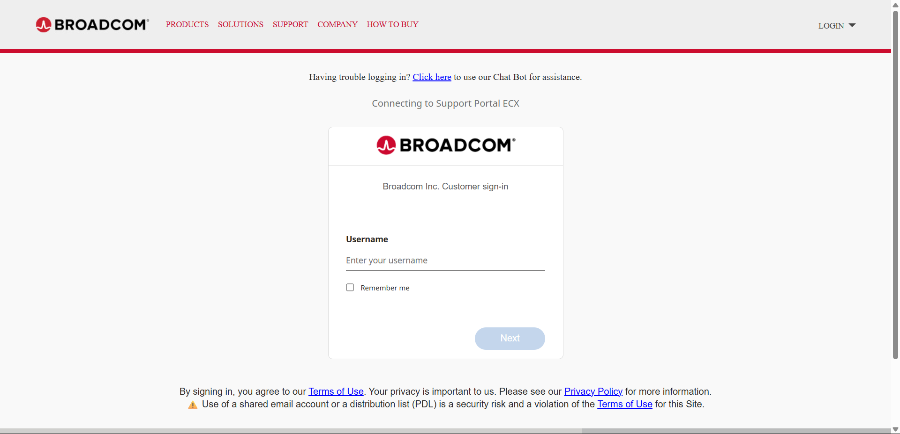

下载入口：

```text
https://support.broadcom.com/group/ecx/productdownloads?subfamily=VMware%20Workstation%20Pro&freeDownloads=true
```

### 选择对应版本


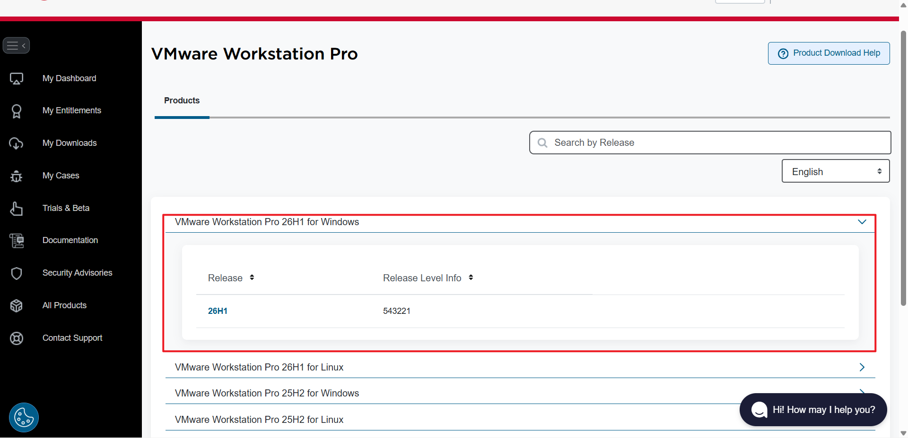


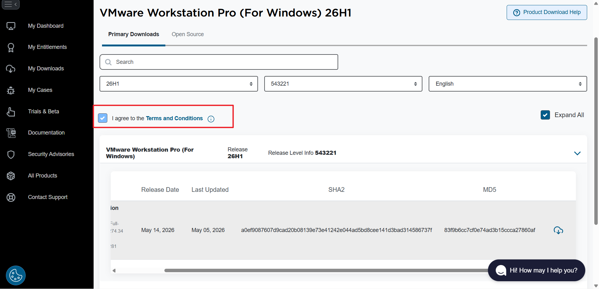

```
I agree to the Terms and Conditions
```

> 这个按钮可能有时候点击不了，多试几次

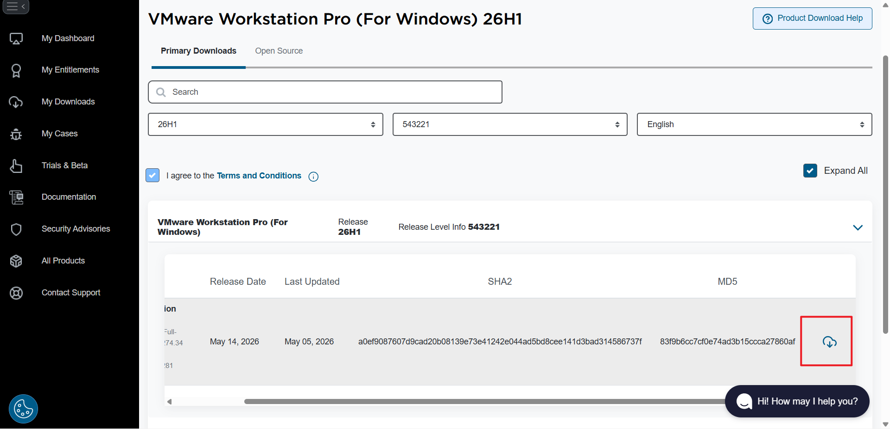

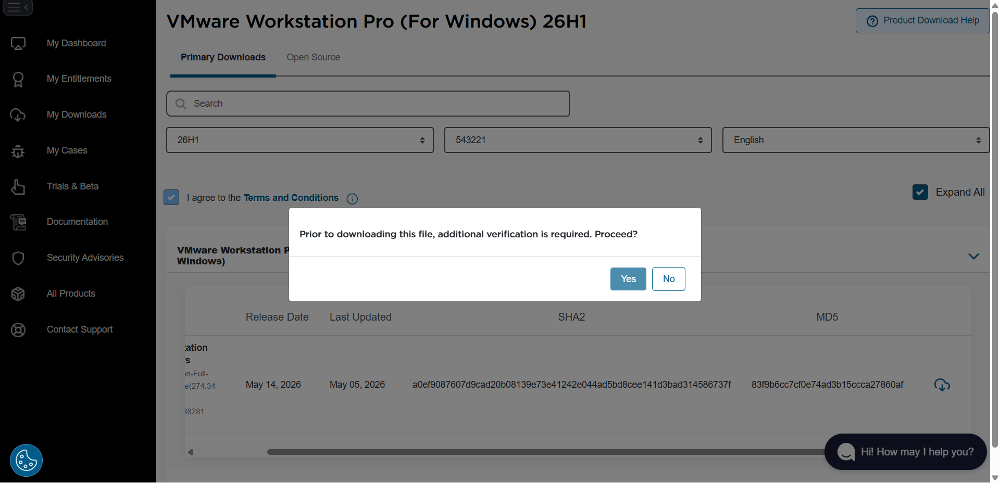

可能需要填写一些信息：

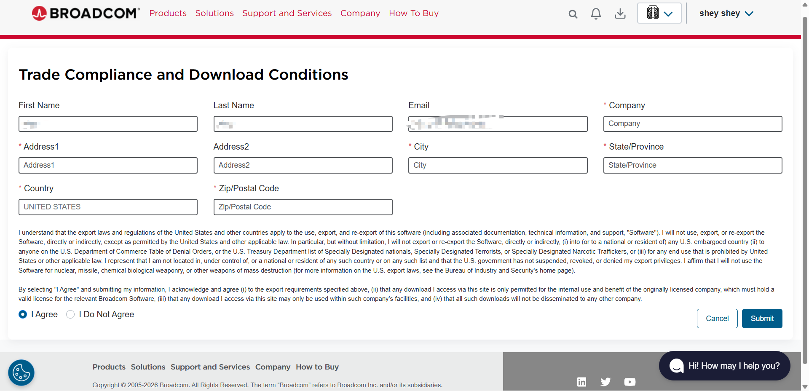

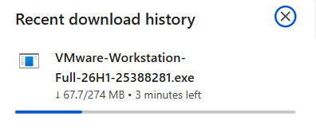

## 开始安装


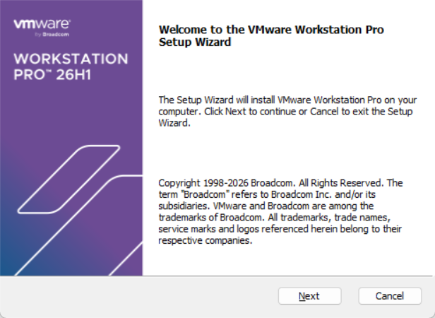

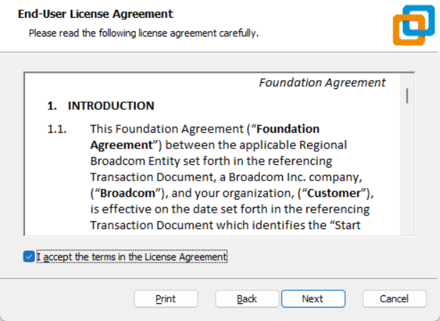

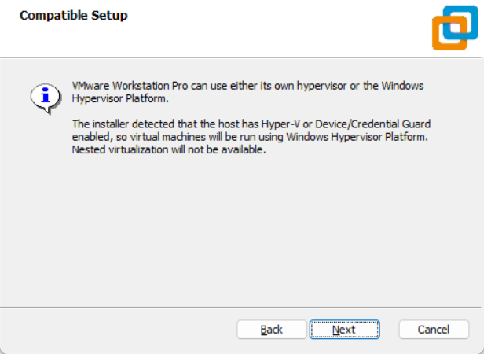

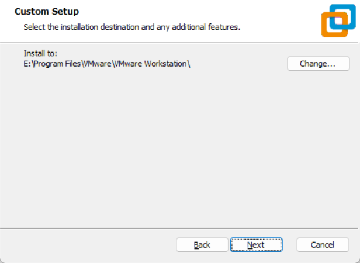
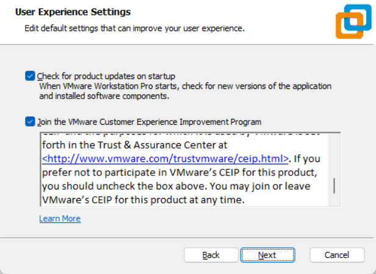
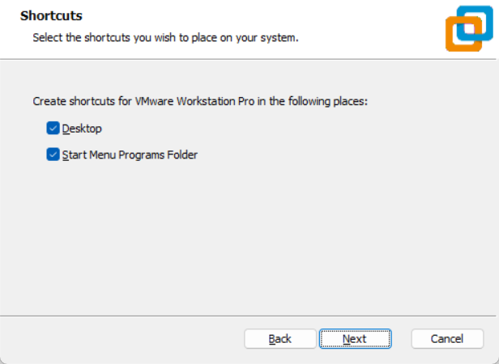
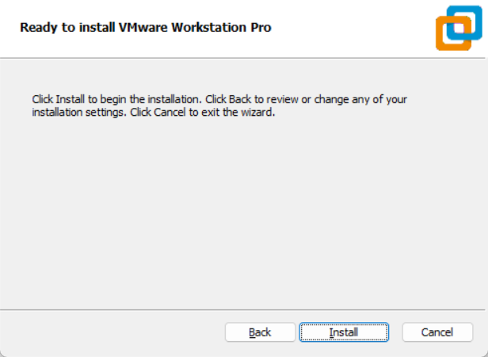
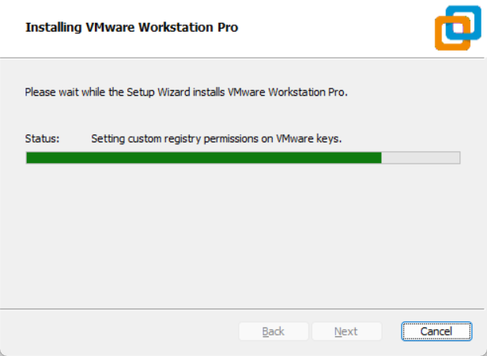
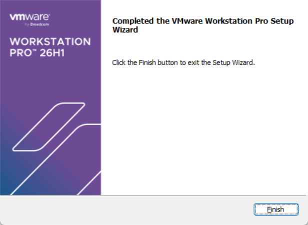
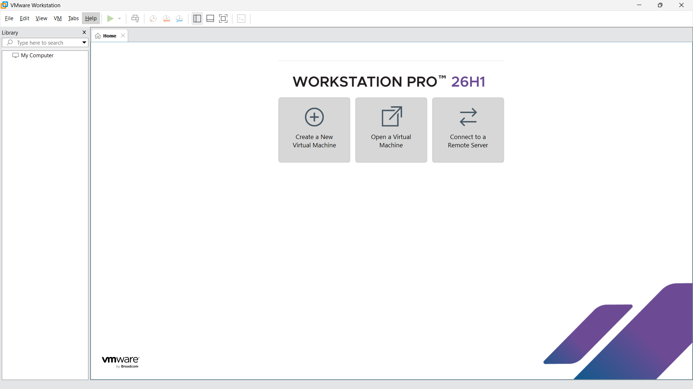