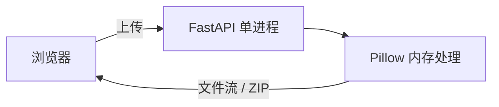

- 仓库：<https://github.com/jiangbyte/imgkit>
- Release：<https://github.com/jiangbyte/imgkit/releases/tag/v1.0.0>

**imgkit** 是即时图像处理小工具：上传即处理、结果直接下载，全程内存、不写磁盘、无需登录。FastAPI 单进程托管 Vue3 前端与 API，一次 `make run` 即可访问。

适合本地或内网随手起一个 Favicon / 压缩 / 缩放 / 转格式服务，不做账号与持久化。

## 特性

- **Favicon 包**：ICO（16/32/48）+ 多尺寸 PNG + apple-touch-icon + `site.webmanifest` → ZIP
- **压缩**：可调质量、输出格式、最长边；默认剥离 EXIF
- **缩放**：最长边或宽×高；`contain` / `cover` / `stretch`
- **格式转换**：WebP / JPEG / PNG（JPEG 透明铺白底）
- **安全底线**：魔数白名单（拒 SVG）、体积 / 像素上限、IP 限流、安全响应头

## 技术栈

- API：Python 3.11+ · FastAPI · Uvicorn · Pillow
- 前端：Vue 3 · Vite · TypeScript
- 启动：`make install && make run` → http://127.0.0.1:8787/
